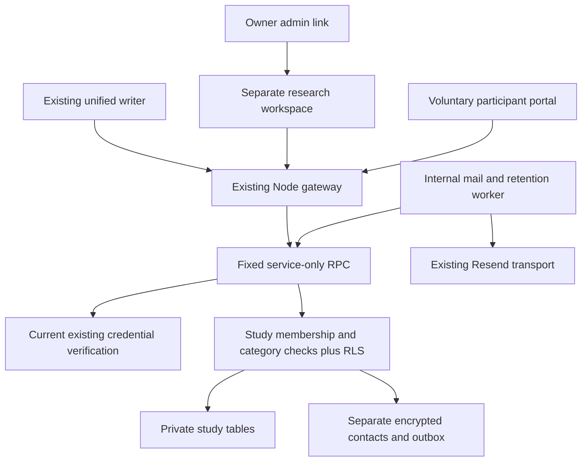
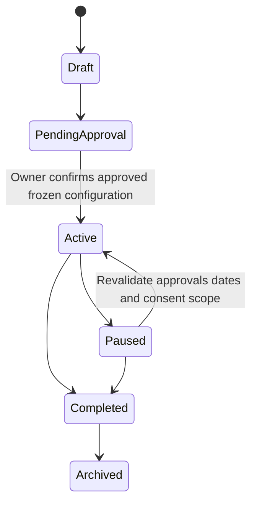
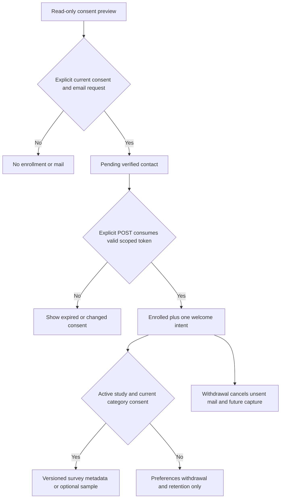
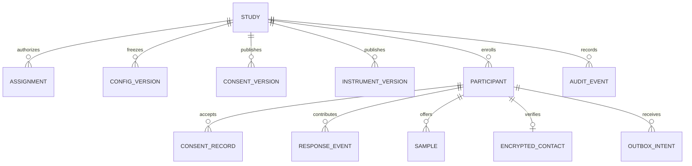
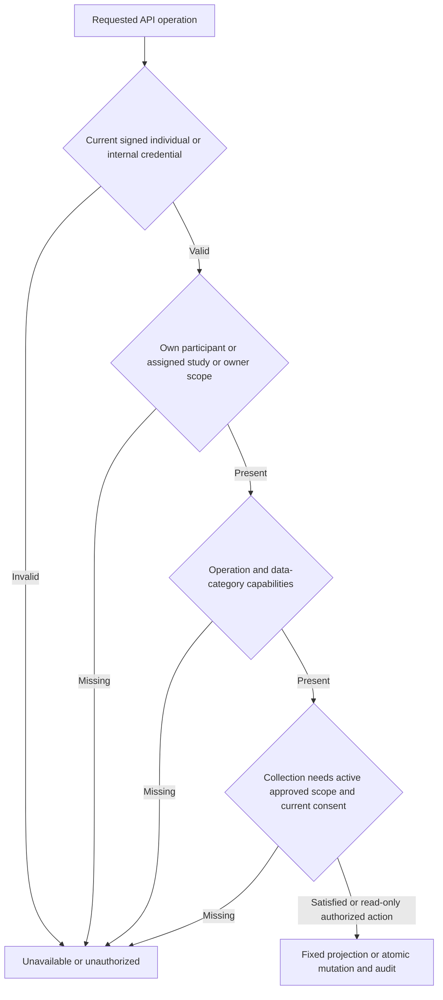

# Communication Principles and Study Research Management - Plan

## Goal Capsule

- Objective: Educators can understand the communication principles while continuing to write easily, and the owner can conduct separately consented studies whose researchers see only their authorized study data.
- Means: Extend the existing unified communication tool and add a separate research workspace with database-enforced study permissions (KTD1–KTD4).
- Authority: The supplied 25-section specification and the user's existing-project/Netlify/no-production-change instructions govern the work.
- Execution: Implement and verify locally on `feat/communication-continuity`, starting at `360dbfa`; preserve the completed communication implementation.
- Delivery: Supply source, migrations, tests and setup evidence. Production migration, deployment, live enrollment/mail and external GitHub export require separate authorization.

---

## Product Contract

### Summary

Group the shared eighteen communication principles in the existing compact drawer. Add owner and assigned-researcher dashboards plus a separate voluntary participant portal. Studies control their consent, instruments, collection, contacts, retention and exports independently.

### Problem Frame

The communication engine already implements eighteen principles, but the drawer does not distinguish the original ten from the additional eight. Existing research flags do not provide study-specific consent or researcher isolation. Research administration needs independent permissions without expanding access to the general administration system or complicating educators' writing.

### Requirements

**Professional communication**

- R1. Preserve one Hebrew RTL tool, `תקשורת מקדמת חוסן חברתי`, with single drafting and ongoing communication using the same AI engine and eighteen principles; conversion preserves source, drafts, sent state and provenance.
- R2. Present the original ten and new eight under `עשרת עקרונות התקשורת` and `שמונה עקרונות לתקשורת מקדמת חוסן`, with short Hebrew explanations in the existing closed drawer; add no compulsory writing questions or checkboxes.
- R3. Preserve full professional functionality for nonparticipants; research questions, optional samples and enrollment remain in a separate voluntary workflow.

**Study administration and isolation**

- R4. Support independent studies with IDs, title, questions, description, PI, researchers, population, dates, approvals, consent/instrument versions, collection/export settings, retention, permissions and system versions.
- R5. Support Draft, Pending Approval, Active, Paused, Completed and Archived states; activation requires the owner's explicit approval confirmation and published required configuration.
- R6. The system owner manages all studies; PI, researcher and assistant work only in assigned studies with least-privilege grants. Ordinary users have no research administration rights.
- R7. Implement all thirteen named permissions: `view_study`, `edit_study`, `manage_questionnaires`, `view_aggregate_results`, `view_pseudonymized_data`, `view_identifiable_data`, `view_document_content`, `export_data`, `manage_participants`, `contact_participants`, `manage_researchers`, `manage_consent`, `view_audit_log`.
- R8. Enforce study, participant and data-category authorization in both PostgreSQL and the API for every operation; unassigned studies cannot be discovered through lists, IDs, counts, search, exports, files or browser restoration.
- R9. A PI can manage collaborators only within the owner's explicit delegation envelope; no role name implicitly grants identity, contact, document, export or collaborator access.

**Participation and collection**

- R10. Enrollment is voluntary and study-specific, recording participant ID, accepted consent version/time/status, contact preferences and withdrawal; existing research booleans confer no new consent.
- R11. Verify longitudinal email ownership and store encrypted contacts separately from responses. Opening consent sends nothing; completed consent plus verification queues one welcome/thank-you message.
- R12. Support configured study expectations, questionnaires/follow-ups, available feedback, updates and contact preferences; withdrawal stops future capture and unsent contact and provides study-policy deletion/retention handling.
- R13. Support optional historical educator-authored samples separately from BE GOOD samples, with category, approximate date, audience, source, used-BE-GOOD flag, consent and minimization status. Missing samples do not exclude an enrolled participant.
- R14. Provide versioned, study-specific questionnaire definitions and schedules, including PLSE/WIFP construct labels marked under development; do not invent validated instruments or a universal score.
- R15. Collect only study-approved metadata for active consented participants: actual tool/principle/prompt/engine/model versions, mode, sessions, drafts, revisions, received-message rounds, audience and observed timing. Optional final content requires separate consent.

**Evidence, exports and data lifecycle**

- R16. Preserve release, tool, principle, prompt, engine/model, consent, instrument, collection-definition and schema version snapshots on research records; significant changes produce new immutable versions.
- R17. Append protected audit events for configuration, activation/pause, grants/revocation, consent, identity/content access, exports and retention without sensitive payloads or secrets.
- R18. Export one authorized study and allowed categories, with pseudonymized defaults, a dictionary and version metadata; identity/document access and export rights remain separate checks.
- R19. Minimize data, use HTTPS and protected storage, deny browser privileged credentials, configure retention, and support withdrawal/deletion without sharing research data across studies.
- R20. Implement and test all twelve mandatory security/regression scenarios from source section 24, including database-enforced cross-study isolation; distinguish local verification from operational production readiness.

### Actors

- A1. System owner/research super administrator: existing authenticated system identity.
- A2. Assigned PI: study-specific capabilities and any explicitly delegated collaborator scope.
- A3. Assigned researcher or assistant: configured study-specific data/report capabilities.
- A4. Educator/participant: unchanged professional access and optional individual study participation.
- A5. Mail/retention worker: internal narrowly scoped server process, never a researcher or browser credential.

### Key Flows

- F1. Educator writes, edits, exports or converts; optional principles explain the shared engine (R1–R3).
- F2. Owner saves draft configuration, publishes versions, confirms approvals and activates; no draft collection occurs (R4–R5, R16).
- F3. Researcher bootstrap opens zero/one/multiple authorized studies and checks grants on every subsequent action (R6–R9).
- F4. Participant opens a scoped invitation, explicitly consents, verifies email by POST, then receives enrollment confirmation and optional activities (R10–R14).
- F5. Successful professional use produces permitted study-local metadata; incompatible consent changes and withdrawal stop collection (R12, R15–R16).
- F6. Authorized reports, downloads and exports use the same database category projections and audit boundary (R8, R17–R19).

### Acceptance Examples

- AE1. Synthetic researcher A sees only Study A; an unknown ID and unassigned Study B return the same unavailable result. The same holds for researcher B (R8).
- AE2. An exporter with pseudonymized-data rights receives no email, identity mapping or communication text. `export_data` alone supplies none of those categories (R7, R18).
- AE3. Opening consent creates no enrollment or mail. Consent and verified email create one enrolled participant in that study and one welcome intent; Study B remains untouched (R10–R11).
- AE4. Committed researcher revocation denies subsequent reads/downloads; committed withdrawal blocks subsequent usage/survey/sample capture and future unsent mail (R8, R12).
- AE5. A new consent or instrument version leaves existing records' original snapshots intact; expanded collection waits for explicit current consent (R16).

### Scope Boundaries

Use the existing project and services. Keep the educational `studies` library and unrelated administration functionality intact. No production migration/deployment, real research enrollment/email, public dataset sharing or GitHub push is part of local verification. Clinical validation, ethics approval and real instruments are supplied by the study owner, never fabricated by software.

Considered and not built: a public searchable catalogue of all studies, because it would disclose unassigned studies; a new authentication service, because existing individual identities can establish ownership; universal resilience scores, because the specification excludes them; durable public export URLs, because authenticated downloads meet the requested workflow with immediate authorization checks.

---

## Planning Contract

### Key Technical Decisions

- KTD1. **Extend the current stack.** Reuse Netlify static HTML, the Render Node gateway, custom HMAC authentication, Supabase/PostgreSQL and Resend (R1, R3, R19). Netlify is carried forward over Base44 at the user's direction; no hosting or auth replacement is needed.
- KTD2. **Separate private study storage.** Add relational study, assignment, version, participant/consent, encrypted contact, response/event, sample/document, outbox and audit tables with required study IDs and composite foreign keys (R8, R19). The existing educational-library bucket and generic `access_settings` rows are unsuitable research stores.
- KTD3. **Authorize inside fixed database RPCs.** Deny direct table/function access to browser roles and direct study-table access to the service role. A restricted non-owner `NOLOGIN NOBYPASSRLS` function role executes pinned-path private helpers with active RLS; service-only exposed invoker wrappers call fixed operations (R8). Because custom tokens are not Supabase Auth JWTs and service keys bypass RLS, the database bridge validates the existing HMAC token and locks/rechecks authoritative current credential, membership, study and consent state in the same transaction. No actor/role claim from a request body is trusted. [Supabase RLS](https://supabase.com/docs/guides/database/postgres/row-level-security), [PostgreSQL RLS](https://www.postgresql.org/docs/15/ddl-rowsecurity.html).
- KTD4. **Project categories in SQL.** The database returns only authorized study metadata, aggregate/pseudonymized records, contact information or document content for each fixed operation (R7–R8, R18). Email visibility requires both identity and contact capabilities; export also requires its selected category grants. Unknown and unassigned identifiers share one error.
- KTD5. **Freeze approved configuration and consent.** Published forms/instruments, activation configuration and submissions are immutable snapshots, protected with constraints/triggers; edits produce new versions (R5, R16). Collection requires active dates/status, configured categories, verified enrollment and current applicable consent. Consent expansion never silently changes prior acceptance.
- KTD6. **Keep research entry separate.** Add an owner link in existing admin to a dedicated RTL research workspace, and assigned-researcher bootstrap using normal individual sessions (R3, R6, R8). Participant entry uses an opaque scoped invitation or own enrollment, with no global catalogue. Sensitive responses use private/no-store; the client clears data on switch/logout/denial and revalidates restored views.
- KTD7. **Protect contacts and mail state.** Use server-only AES-GCM encryption with a configured contact key, hashed expiring one-use verification tokens, and a durable encrypted outbox (R11–R12, R19). Verification requests atomically enforce server-configured participant/study/destination cooldowns and send quotas, including pending email replacement, and reuse an unexpired outstanding intent. Reuse native-fetch Resend delivery with immutable payloads and provider idempotency. Ambiguous acceptance beyond Resend's 24-hour deduplication window remains unresolved rather than automatically resending; the owner sees that state and can reconcile established acceptance/non-acceptance through an audited manual action. [Resend idempotency](https://resend.com/docs/dashboard/emails/idempotency-keys).
- KTD8. **Record observed, scoped research events.** Successful communication operations can emit versioned allowlisted metadata only for active approved enrollments (R15–R16). Use study-local identifiers and idempotent event keys; document the definitions and mark client timing as reported. Research-storage failure never blocks professional output. Final text is submitted explicitly with separate consent and verified BE GOOD provenance where available; legacy pasted samples are labelled as participant declarations.
- KTD9. **Verify actual SQL locally.** Use pinned test-only PGlite 0.5.9 in `work/`, with pgcrypto and explicit role/RLS capability probes before migration tests (R20). Keep it out of production runtime dependencies. It proves sequential PostgreSQL permissions/policies/constraints, while hosted PostgREST grants and real concurrent revocation remain authorized staging checks. [PGlite extensions](https://pglite.dev/extensions/).
- KTD10. **Maintain existing transport compatibility.** New native-fetch research calls support both legacy JWT service-key headers and opaque secret keys on `apikey` (R19). Do not rotate production credentials. Release validation uses an available supported Node LTS; remote runtime changes remain a release action. [Supabase key migration](https://supabase.com/docs/guides/getting-started/migrating-to-new-api-keys), [Node releases](https://nodejs.org/en/about/previous-releases).

### High-Level Technical Design



```mermaid
sequenceDiagram
  participant User
  participant API
  participant DB
  User->>API: Authenticated scoped operation
  API->>API: Validate action and input; use existing identity
  API->>DB: Fixed RPC with existing signed credential
  DB->>DB: Lock and verify credential, assignment, study and consent
  DB->>DB: Authorized projection or mutation plus audit/receipt
  DB-->>API: Scoped result or indistinguishable unavailable result
  API-->>User: Private/no-store response
```









| Communication mode | Approved active study with applicable consent | Current consent absent, pending or withdrawn |
| --- | --- | --- |
| Single | Allowlisted observed metadata; final text only with separate content consent | Professional writing only, no research capture |
| Ongoing | Allowlisted observed metadata; final text only with separate content consent | Professional writing/history only, no research capture |

Operation names and payload details are fixed in U1 before independent implementation units begin.

### Assumptions and Release Dependencies

Real study consent wording, instruments, approvals, population, retention rules and contact cadence are owner configuration required for activation. Initial participant identity uses existing personal staff/administrator or system identity; shared institutional/open/course sessions cannot silently establish individual participation. Study-specific invitation eligibility remains explicit configuration.

The current local Node runtime and hosted database version must be recorded during verification. Live credentials, verified Resend sender, contact encryption key, approved study protocol and authorized migration are release prerequisites. PGlite does not prove hosted role-switch restrictions or two-session concurrency; provide executable staging checks for those boundaries. Previously authorized downloaded exports and already accepted email cannot be recalled.

### System-Wide Impact

Research navigation must preserve the existing general admin guard, normal sign-in and unrelated educational library. Writer result handling gains a consent-aware optional metadata hook, not questionnaire fields or a new writing engine. New data does not enter generic pipeline/public job endpoints, generic admin exports, browser persistence or demo examples. Migrations are additive and unapplied.

---

## Implementation Units

### U1. Shared research contracts and visible principles

**Goal:** Freeze shared versions/operation/permission contracts and present the requested grouped principles.

**Requirements:** R1–R3, R7, R16; F1.

**Dependencies:** Completed unified implementation at `360dbfa`.

**Files:** `app/lib/communication-core.js`, `app/message-writer.html`, `app/lib/communication-continuity-ui.js`, `app/lib/communication-continuity.css`, new `app/lib/research-core.js`, `docs/research-api-contract.md`, `harness/tests/research-core.test.mjs`, relevant existing communication UI tests.

**Approach:** Preserve existing principle text/prompt meaning while adding labelled Hebrew explanation groups. Establish one frozen action/permission/version vocabulary and the scoped request/result shapes needed by U2–U4. Increment the tool/application release for visible/research integration; keep unchanged prompt/engine/principle provenance.

**Patterns:** Existing UMD communication core, compact `details` panel and immutable constants.

**Test scenarios:**
1. Both modes show exactly ten plus eight principles with continuous numbering and a closed default panel.
2. A short natural instruction still generates without research fields, mandatory questions or stored single history.
3. Old signed document provenance remains unchanged after the release increment.

**Verification:** Focused core/UI contracts and existing single/ongoing tests pass; shared worker contracts are committed before the parallel wave.

### U2. Database study isolation and native transport

**Goal:** Implement real database authorization, transactions, immutable versions and category-specific storage/projections.

**Requirements:** R4–R12, R14–R20; F2–F6; AE1–AE5; KTD2–KTD5, KTD9–KTD10.

**Dependencies:** U1 frozen contract. U3/U4 consume that contract independently; they do not edit these files.

**Files:** New `harness/migrations/20261013-research-management.sql`, `harness/lib/research-store.mjs`, `harness/tests/research-store.test.mjs`, `harness/tests/research-database.test.mjs`, `harness/fixtures/research-database.mjs`.

**Approach:** Implement KTD2–KTD5 as fixed RPC operations, including current auth verification, composite study ownership, delegated grants, state/consent guards, scoped receipts, safe projections, outbox transitions and retention. Use no arbitrary relation/column or client-provided owner. Preserve existing auth/professional tables and default grants outside the new research objects.

**Execution note:** Prove denied cross-study/database role operations before implementing the permitting SQL. Run the complete migration unchanged in the isolated engine; do not remove unsupported security clauses to make a fixture pass.

**Patterns:** Existing native-fetch store error handling; PostgreSQL transactional RPC and private functions.

**Test scenarios:**
1. Covers AE1. Two assigned researchers list/read only their own studies; all foreign IDs and unknown IDs are indistinguishable.
2. `anon`, `authenticated` and direct service-role table access fail; invalid/expired/revoked custom credentials fail inside SQL.
3. Covers AE2. SQL previews/exports omit identities, contacts and text without their separate grants; altered nested participant/sample/instrument IDs cannot widen scope.
4. Covers AE3/AE5. Atomic enrollment/verification and immutable consent/instruments preserve versions and reject stale or foreign submissions; repeated requests and pending-address replacement cannot bypass verification send quotas or duplicate an unexpired intent.
5. Covers AE4. Subsequent access/collection fails after committed membership revocation, pause, withdrawal or credential revocation.
6. Duplicate mutation receipts, stale expected revisions, audit immutability, frozen-version edits, failed-transaction rollback and study-scoped erasure behave correctly.
7. Missing/foreign RLS context fails closed; definer role is non-owner/non-bypass, and function/schema execute grants are constrained.
8. Legacy and opaque secret-key headers, storage failure/status mapping and JSON payload boundaries are verified without real credentials.

**Verification:** Actual SQL isolation/capability tests pass and record engine/version limitations; injected HTTP transport tests pass. Migration remains unapplied to production.

### U3. Research API, consent, surveys, samples and mail

**Goal:** Expose validated study/participant operations and implement verified contact plus durable study mail processing.

**Requirements:** R4–R20; F2–F6; AE1–AE5; KTD4–KTD8.

**Dependencies:** U1 frozen store/action contracts; integrate with U2 after both independent results land.

**Files:** New `harness/lib/research.mjs`, `harness/lib/research-mail.mjs`, `harness/tests/research-backend.test.mjs`, `harness/tests/research-mail.test.mjs`, `harness/fixtures/research-scenarios.mjs`.

**Approach:** Reuse signed individual/system sessions, validate and allowlist inputs, invoke fixed database operations, and reject role/owner/category spoofing. Provide versioned instruments and sample metadata with separate content consent; use approved actual source provenance for BE GOOD samples. Encrypt contacts/outbox payloads with a configured key. Implement verification, welcome, due questionnaires, approved updates/feedback and withdrawal-aware mail dispatch per KTD7.

**Execution note:** Start with scoped authorization, consent and mail transition regressions; fixtures use synthetic identities/emails/providers only.

**Patterns:** Existing handler `[status,out]` contracts, content-free errors, explicit consent and Resend native fetch.

**Test scenarios:**
1. Ordinary/shared sessions cannot administer studies; assigned PI/researcher/assistant receive only granted operations and owner-approved collaborator scope.
2. Opening draft/consent produces no data collection/mail; explicit current consent plus verification is required, and replay queues one welcome.
3. Expired/used/foreign tokens, replaced email, stale consent, paused study and withdrawal reject capture/contact without changing ordinary writer output.
4. Study A consent never enrolls or collects into B; historical sample omission has no effect on participation.
5. Instruments validate configured item types/answers and retain consent/instrument/version snapshots without a universal score.
6. Optional samples require own-authorship/minimization confirmation; document reads and exports require the correct separate grants.
7. Encrypted contacts/tokens do not appear in public results, logs or pseudonymized exports; CSV cells cannot become intended formulas and a dictionary/version manifest accompanies exports.
8. Missing mail configuration is visible; provider errors, duplicate claims, lost acceptance, expired deduplication windows and withdrawal cancel/recheck are covered by synthetic delivery tests. Verification-request cooldowns also apply to pending address changes.

**Verification:** Focused API/mail suites pass with real SQL integration delegated to U5/U6; no real email or participant collection occurs.

### U4. Owner, researcher and participant RTL interfaces

**Goal:** Build useful separate research interfaces with only authorized controls and clean ordinary writing.

**Requirements:** R3–R14, R16–R19; F2–F6; KTD6.

**Dependencies:** U1 action/result contracts. U2/U3 use disjoint files and integrate afterward.

**Files:** New `app/research-management.html`, `app/research-participation.html`, `app/lib/research-client.js`, `app/lib/research-management-ui.js`, `app/lib/research-participation-ui.js`, `app/lib/research.css`, `harness/tests/research-ui.test.mjs`.

**Approach:** Owner dashboard supports requested counts, configuration, researchers/grants, forms/schedules, reports, exports and audit. Researcher bootstrap shows only zero/one/multiple assigned-study states. Participant portal separates invitation disclosure, consent, explicit verification, optional questionnaires/samples, preferences and withdrawal. Preserve pending field input on recoverable failures while clearing private data on lost authorization.

**Patterns:** Existing Hebrew RTL cards, optional details, explicit actions, safe text rendering and no new persistent research cache.

**Test scenarios:**
1. Owner creates a draft and sees all permitted studies; one-study researcher opens directly and sees no other-study counts/navigation.
2. Direct foreign study routes and revoked sessions clear results and show unavailable; logout/account switch/pageshow do not restore prior data.
3. UI rights cannot enable an API operation; no contacts, text, export or collaborator controls appear without the relevant grants.
4. Consent preview has no mutation; verified enrollment exposes optional forms/samples and explicit preferences/withdrawal, while changed forms show recoverable current-version messages.
5. Instrument/consent builders, permission controls, result/export screens and mobile RTL layout work without inserting forms into the professional writer.
6. The owner sees unresolved provider acceptance and can record an established outcome through the audited reconciliation action; no automatic duplicate send occurs.

**Verification:** Focused UI tests and actual integrated browser journeys cover owner, researcher and participant flows.

### U5. Gateway, navigation, professional metadata and worker integration

**Goal:** Wire the completed boundaries into the existing project without exposing privileged data or blocking writing.

**Requirements:** R1, R3, R8, R11–R12, R15–R20; F1–F6.

**Dependencies:** U2–U4 integrated.

**Files:** `harness/practice-server.mjs`, `harness/lib/communication-continuity.mjs`, `harness/lib/communication-single.mjs`, `app/admin.html`, `app/lib/access-guard.js`, relevant existing home/navigation scripts, new `harness/research-worker.mjs`, `harness/research-browser-check.mjs`, `harness/tests/research-http.test.mjs`, `harness/tests/research-usage.test.mjs`.

**Approach:** Add private/no-store bounded research routes and owner/admin links without changing general admin authorization. Collect successful allowlisted events only under current study consent; convert/retry events do not duplicate original observations. Internal worker schedules approved due mail/retention without a public bypass route. Keep real dispatch disabled until configured and authorized.

**Test scenarios:**
1. Actual gateway denies foreign study exports/downloads, returns safe statuses/headers and exposes no raw content in logs.
2. Nonconsenting generation creates no research records; Study A consent captures only allowed versioned A metadata, and withdrawal/study pause prevents later capture.
3. Single/ongoing writing, all revisions and conversion still work when research storage/mail are absent or failing.
4. Owner navigation opens research; assigned researcher uses dedicated bootstrap without full admin access; ordinary user is denied research administration.
5. Internal due-mail processing respects configured schedules, current verification/preferences and withdrawal; no real mail is sent in tests.

**Verification:** Full existing/new suite and browser journeys pass against the integrated UI/API/SQL fixture.

### U6. Complete security evidence and delivery

**Goal:** Resolve review findings and deliver a verifiable implementation, migration and setup package.

**Requirements:** R16–R20 and source section 25.

**Dependencies:** U1–U5.

**Files:** New `docs/research-management.md`, `docs/research-management-qa.md`, scoped review receipts/resolution, optional real-PostgreSQL staging test runner; output source ZIP/guide/QA artifacts.

**Approach:** Check all source requirements and twelve mandatory scenarios, run simplification and actual code review, resolve material findings, and package committed tracked files. Record local test engine, actual results, version dictionary and external release prerequisites. No production action or external source export is inferred from local completion.

**Test scenarios:**
1. All source security tests have explicit executable API/database/UI evidence, including positive allowed paths as well as denial.
2. Archive contains final tracked source, unapplied migration, tests and receipts with matching release versions/hash.
3. Setup and authorized staging instructions distinguish sequential local PostgreSQL proof from live Supabase concurrency, approvals, email delivery and deployment readiness.

**Verification:** Completed review/resolution receipt, passing feasible checks and readable verified package; any external dependency is stated without claiming operational production features.

---

## Verification Contract

Use proof-first authorization/consent tests and characterization of the existing writer. Run `node --test` from `harness`, focused research suites, unchanged migration against isolated PGlite, and `harness/research-browser-check.mjs` with the real gateway/UI/SQL fixture and synthetic mail/model responses. Existing 263 tests/26 browser journeys are baseline evidence, not proof of new research security.

SQL verification includes grants, RLS roles, token/current-credential checks, foreign study and child IDs, category projections, immutable versions/audit, transaction rollback, revocation, consent and retention. Browser verification includes desktop/390px RTL, assigned landing, direct URLs, contact/content suppression, safe exports, consent/verification, optional questionnaires/samples, cache/restore/logout and writer regressions.

Record a real-PostgreSQL two-session revocation/CAS test for authorized staging. Hosted Supabase default grants, exposed schemas, PostgREST/API-key proxying, sender verification, live AI/OCR quality, real email delivery and production runtime validation remain external release checks. Never weaken or skip a local isolation assertion and then declare it verified.

---

## Definition of Done

Every R1–R20 has implemented behavior and relevant tests. All twelve source security scenarios are verified locally through the appropriate boundaries. Shared writing remains usable without research, and no preexisting data/auth/library functionality is replaced. Study/consent/instrument/system versions and audit records preserve history.

All justified review findings are resolved, source scope contains no abandoned experimental implementation, full feasible checks pass, and complete tracked source/migrations/run/QA artifacts are delivered. No production deployment, migration, live enrollment/email or unauthorized GitHub push occurs. Operational readiness is claimed only for boundaries actually implemented and tested.
