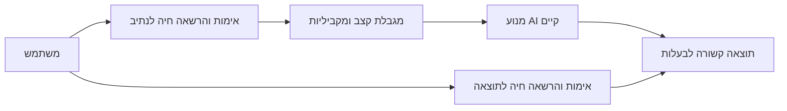
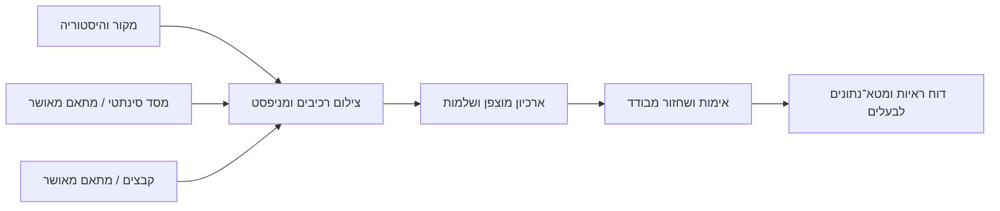

# BE GOOD — אבטחה, גיבוי ושחזור והתאמה לבית הספר

## Goal Capsule

**Objective:** בעלת BE GOOD יכולה לבדוק מה מוגן, לשחזר עותק בדיקה מבודד, ולהחליט על הפעלת ההגנות באתר מתוך ראיות ותוכנית חזרה לאחור.

**Means:** ענף פיתוח מבודד, תיקוני גישה בצד השרת, גיבוי מוצפן ובדיקות עם נתונים סינתטיים (KTD1–KTD4).

הוראות המשתמשת גוברות על קובצי העבודה. פעולות רמה A מאושרות; רמות B/C דורשות אישור מפורש. אין push, פריסה, שינוי שירות חי, סבב מפתחות או קריאת רשומות משתמשים. השינויים המקומיים בענף Communication Continuity נשמרים ואינם נכללים בשינוי לא מבוקר. המימוש והבדיקות מקומיים; הפעלת ייצור היא פעולה נפרדת של הבעלים.

## Product Contract

### Summary

לסגור פערי גישה שהוכחו בקוד, לשמר את המקור ואת היסטוריית הפיתוח, ולספק כלים ותיעוד לגיבוי ושחזור עם דיווח אמיתי על רכיבים חסרים. התאמת הכלים לבית הספר נכללת במסלול הפיתוח אחרי שער ההגנה, תוך שימוש בתשתיות הקיימות.

### Problem Frame

הנתיבים הכלליים ל־AI מאפשרים דילוג על אימות כאשר תצורת Supabase חסרה. בדיקת תוצאות רקע אינה דורשת אימות. אין במאגר הוכחה למדיניות RLS של scenarios או למערך גיבוי עצמאי הכולל את הקבצים בפועל. עותק קוד או בדיקת ממשק אינם מוכיחים שחזור מערכת מלאה.

### Requirements

- **R1:** לשמר את כל היסטוריית Git הזמינה, הענפים, התגים והקבצים המקומיים ששונו או טרם הוכנסו ל־Git; לתעד רכיבים שלא ניתן היה להגיע אליהם.
- **R2:** כל בקשת AI דורשת אימות תקף והרשאה חיה מתאימה לנתיב. תצורה חסרה או תקלה בבדיקת הרשאה חוסמות את הבקשה.
- **R3:** תוצאות רקע נגישות רק לכניסה המאומתת שיצרה אותן, בנפרד מזהות הקוד/המוסד המשותפים המשמשים למכסות; ביטול גישה חל גם על בדיקת תוצאות. לכל כניסה מזהה אקראי חתום, ולסדנה דרושה הוכחת כניסה נפרדת לפני שימוש בתוצאות רקע. אין לשמור אסימונים גולמיים במטא־נתוני משימות. אין לטעון שזהות כניסה מוכיחה זהות אישית.
- **R4:** להגביל בקשות מקבילות וקצב בקשות לפי זהות מאומתת ומוסד; לתעד במפורש את גבולות ההגנה במספר מופעי שרת.
- **R5:** להסיר סיסמאות ניהול ברירת מחדל, להכין בדיקת קטלוג SQL והרשאות ונתיב תיקון מוסדי עם נתונים סינתטיים בלבד. אין להריץ migration חי.
- **R6:** גיבוי כולל מקור והיסטוריה, מסד ונתונים והרשאות, קבצי Storage, הפניות תצורה ומניפסט; להצפין ולאמת שלמות. גיבוי חסר לא יקבל מצב תקין.
- **R7:** שחזור לעותק חדש מבודד; למנוע כתיבה מעל יעד קיים, יציאה מהיעד וקישורים לא בטוחים. לבדוק פגיעה בקובץ, מפתח שגוי וקשרים בין נתונים לקבצים.
- **R8:** ממשק בעלים בלבד מציג גיבוי, שחזור ורציפות פעילות, עם מצב לא מוגדר כשהמערכת אינה מחוברת. אין להציג סימולציה כגיבוי חי.
- **R9:** שבעת קובצי MD בעברית כוללים ממצאים, תוכנית, ארכיטקטורה, הוראות שחזור, תוצאות, מפת פרטיות ואישורים נדרשים.
- **R10:** התאמה לבית הספר מפותחת בהדרגה: פרופיל מוסדי בעל גרסאות והרשאות, הקשר משותף לשני כלים קיימים וחיבור למסע הקיים. שימוש בכלים ללא פרופיל נשאר אפשרי. אין מנוע AI נוסף או איסוף תלמידים מיותר.
- **R11:** מימוש ההסכמים, החתימות, ניהול התרומות והכלי המאוחד נשאר בתוכנית; אין להציגם כמופעלים בייצור לפני שבדיקות, תלויות ואישורים הושלמו.

### Key Decisions

- **בטיחות וגיבוי קודמים לתכונות חדשות** — `session-settled: user-directed`; governs R1–R9. החלופה של המשך פיתוח גדול לפני ההגנה נדחתה במפורש.
- **המערכת פועלת ב־Netlify** — `session-settled: user-directed`; governs R2, R6, R8. אין מעבר ל־Base44.
- **אין פריסה בלי אישור הבעלים** — `session-settled: user-directed`; governs R1–R11.

### Acceptance Examples

- בקשת AI עם MODEL_AUTH=off ובלי תצורת אימות מחזירה חסימה, בלי פנייה לספק.
- מורה א׳ יוצר משימה; מורה ב׳ אינו יכול לקרוא את תוצאתה באמצעות מזהה ידוע. לאחר ביטול הרשאת א׳ גם א׳ נחסם.
- שחזור נתונים וקבצים סינתטיים מייצר אותם קשרים ביעד חדש; קובץ פגום ומפתח שגוי אינם מייצרים שחזור תקין.
- דף בעלים מציג במפורש שהגיבוי העצמאי טרם הופעל, עד שיש מפתח, יעד עצמאי ומדיניות מאושרת.

### Deferred to Follow-Up Work

R10 יתחיל לאחר ראיות לשער גיבוי והרשאות; בפרק הנוכחי יתועד חוזה המימוש והמידע המוסדי הקיים, בלי להרחיב כעת איסוף מידע אישי. R11 ממשיך על בסיס הענף הקיים לאחר שילוב תיקוני הבטיחות. רמות B/C אינן תנאי להשלמת העבודה המקומית, אך הן תנאי לטענה שהמערכת החיה מוגנת.

## Planning Contract

### Key Technical Decisions

- **KTD1:** בסיס העבודה הוא main ב־f42d8b6 בענף feat/security-backup-recovery ובשכפול עצמאי. המקור המלוכלך נשאר ללא שינוי. Git bundle אינו מכסה שינויים לא־מוכנסים ולכן נדרש גם צילום קובצי עבודה מוצפן.
- **KTD2:** להשתמש באימות ובהרשאות הקיימים; לקשור הרשאה לנתיב ובעלות למשימה. להסיר מעקף MODEL_AUTH ולבדוק כל polling מול הרשאה חיה. לא להוסיף דגל ייצור שמחליף אימות.
- **KTD3:** מנגנון גיבוי מקומי מוצפן עם AES-GCM ומפתח גיבוי הנשמר בנפרד; מניפסט ומצב כיסוי מפורשים. מתאמי DB/Storage חיים דורשים אישור, כלי PostgreSQL ומפתח יעד. עותק באותו מחשב אינו יעד עצמאי.
- **KTD4:** בדיקת שחזור מסד סינתטי עם PGlite זמינה מקומית. היא תוכיח SQL ונתונים וקשרים, אך לא תחליף בדיקת pg_dump/roles של Supabase או אימות RLS חי.
- **KTD5:** מטא־נתוני גיבוי בלבד נחשפים לדף הבעלים באמצעות הרשאת sys חיה. דף לא מציע פעולות שחזור ייצור או הורדת ארכיון.

### High-Level Technical Design

מצבי הגיבוי: לא מוגדר → נאסף → מוצפן → אומת → שוחזר בבדיקה. כישלון בכל שלב מחזיר מצב כשל ולא משנה דוח הצלחה קודם. ההפעלה החיה דורשת שער אישור נפרד.

### Sources

ממצאי מקור: harness/practice-server.mjs; harness/lib/access.mjs; harness/lib/studio.mjs; app/lib/access-guard.js; app/lib/sbe-db.js. תשתית מוסדית: מוסדות, הרשאות ו־journey קיימים. מסמכי Supabase רשמיים קובעים שגיבוי DB אינו כולל את תוכן Storage: https://supabase.com/docs/guides/platform/backups . קריפטוגרפיה: https://nodejs.org/api/crypto.html . Git: https://git-scm.com/docs/git-bundle .

## Implementation Units

### U1. שימור וביקורת

Goal: בסיס מתועד ושימור שאינו משנה את המקור. Requirements: R1, R5, R9.
Files: docs/requirements/security-recovery-user-instructions.md; שבעת דוחות MD; scripts/security-audit.mjs; כלים חיצוניים בתיקיית work בלבד.
Approach: כל refs בשכפול, סקירת סודות ללא חשיפת ערכים, מטא־נתוני שירות בלבד. תעד לא ידוע בנפרד מממצא.
Test Scenarios: canary סינתטי מזוהה; דוח אינו מדפיס ערכי סודות; ענף המקור ושינוייו זהים לפני ואחרי.
Verification: Git refs + hash של diff וקובצי עבודה; בדיקת canary; בדיקת דוחות.

### U2. AI והרשאות

Goal: נתיבים ותוצאות חסומים ללא הרשאה. Requirements: R2–R5.
Files: harness/practice-server.mjs; harness/lib/access.mjs; harness/lib/studio.mjs; מודול מגבלות חדש; app/lib/access-guard.js; app/lib/ai-call.js; בדיקות מודל/Studio/שרת.
Approach: gate משותף, endpoint allowlist, בעלות והרשאה חיה ל־polling; זהות מוסד נגזרת מהאימות ולא מטקסט לקוח. סיסמאות ניהול מוקמות רק דרך תהליך תצורה מפורש.
Execution note: להוכיח בדיקה נכשלת לפני תיקון ההתנהגות; אין קריאות AI אמיתיות.
Test Scenarios: אימות חסר/פגום/מבוטל; תצורה חסרה; הרשאת כלי שגוי; polling בין בעלי קוד; עומס מחזיר 429; מנהל ללא סיסמה מוגדרת נחסם.
Verification: node --test harness/tests/model-auth.test.mjs harness/tests/studio-backend.test.mjs והבדיקות החדשות.

### U3. גיבוי ושחזור

Goal: ארכיון מוצפן ובדיקת שחזור ממשית מבודדת. Requirements: R1, R6, R7, R9.
Files: scripts/backup.mjs; harness/lib/backup-archive.mjs; harness/tests/backup-recovery.test.mjs; תבניות תצורה ללא סודות.
Approach: ארכיון עם גרסה ומניפסט מאומת, API לאיסוף ושחזור רכיבים; source bundle וקבצי עבודה; הפעלת DB/Storage אמתית אינה אוטומטית.
Execution note: תחילה בדיקות נגד אובדן/שינוי ארכיון וכתיבה ליעד קיים.
Test Scenarios: round-trip קבצי Hebrew/binary; מפתח שגוי; corruption; traversal; רכיב חסר; שחזור SQL ל־PGlite וקשרים לקבצים; הפעלת השרת והממשק מתוך תיקיית המקור המשוחזרת עם זהויות וספק AI סינתטיים, כניסה, בידוד מוסדי, תרגול, שמירה והצגת תוצר; שחזור גרסת קוד קודמת ליעד אחר.
Verification: node --test harness/tests/backup-recovery.test.mjs; תרגיל שחזור נפרד מתוך המקור המשוחזר עם תוצאות לכל זרימה וזמני התחלה וסיום. בדיקות במאגר הפיתוח אינן תחליף לכך.

### U4. מסך בעלים והרשאות נתונים

Goal: מצב אמיתי ונגיש רק לבעלים; מסלול תיקון DB מוכח סינתטית. Requirements: R5, R8, R9.
Dependencies: U2, U3.
Files: app/admin.html; app/lib/backup-monitor-ui.js; harness/lib/backup-monitor.mjs; SQL קטלוג ומיגרציה מוכנה; בדיקות גישה/תצוגה.
Approach: הרשאת sys חיה, תשובת not_configured בלי backend פעיל, מטא־נתונים ללא סודות. ACL של access_settings ו־Storage נבדק סינתטית; scenarios ציבורי/פרטי מחייב מיפוי לפני הפעלה חיה.
Test Scenarios: sys מורשה; חוקר/מוסד/קוד מזויף חסום גם ב־API; נתוני ניטור פגומים לא מוצגים כתקינים; RTL desktop/mobile.
Verification: בדיקות יחידה/HTTP ודפדפן מקומי.

### U5. שילוב, מסמכים וביקורת

Goal: חבילה קונקרטית להחלטת בעלים והמשך התאמה לבית הספר. Requirements: R9–R11.
Dependencies: U1–U4.
Files: שבעת דוחות MD; docs/plans/2026-10-14-school-adaptation-follow-up.md; outputs מחוץ למאגר.
Approach: לשלב את הממצאים והראיות בדוחות, לסמן כל תלות חיה, לשמר פיתוח קודם, review ותיקונים מקומיים לפני מסירה.
Test Scenarios: אין טענת full backup/RLS/signature/הגנת ייצור שאינה מוכחת; כל אישור כולל פעולה וסיכון וחזרה לאחור.
Verification: בדיקות harness, node --check, git diff --check, סקירת קוד עצמאית ותיעוד תוצאות.

## Verification Contract

Node 24 המקומי; אין credentials חיים בסביבת הבדיקות. בדיקות synthetic משתמשות ב־memoryStore/PGlite. אין POST לשירותי production. דפדפן מקומי בלבד. בדיקות מלאות לאחר שילוב, ורק בדיקות ממוקדות חוזרות אחרי תיקון. פרטיות: לא להדפיס matches של סודות. אין בדיקת restores על נתוני אמת.

## Definition of Done

התיקונים המקומיים עוברים את תרחישי U2; ארכיון ושחזור U3 מוכחים; מסך U4 מציג מגבלות אמיתיות; שבעת המסמכים בעברית מקשרים לראיות ולפעולות האישור. המקור נשמר. קוד ניסיוני שנזנח מוסר. שינויים נשמרים ב־commits מקומיים בענף הייעודי, ללא push. מצב הייצור והגיבוי העצמאי מסומנים כלא מאומתים עד פעולות B/C שאושרו והושלמו.
