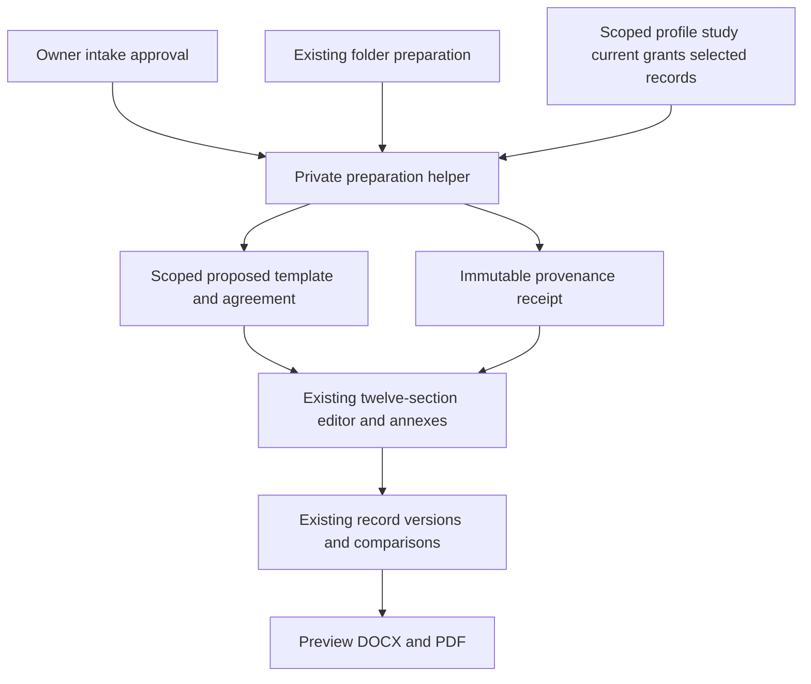
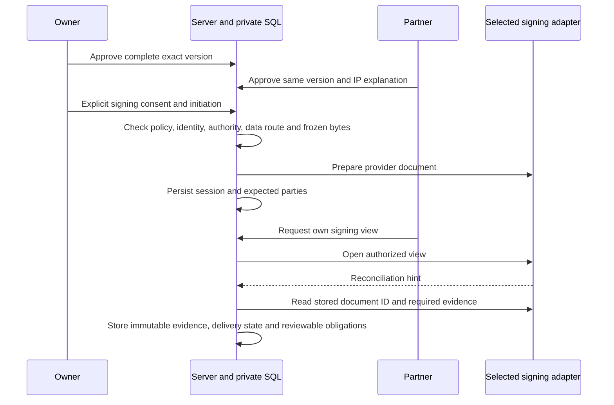
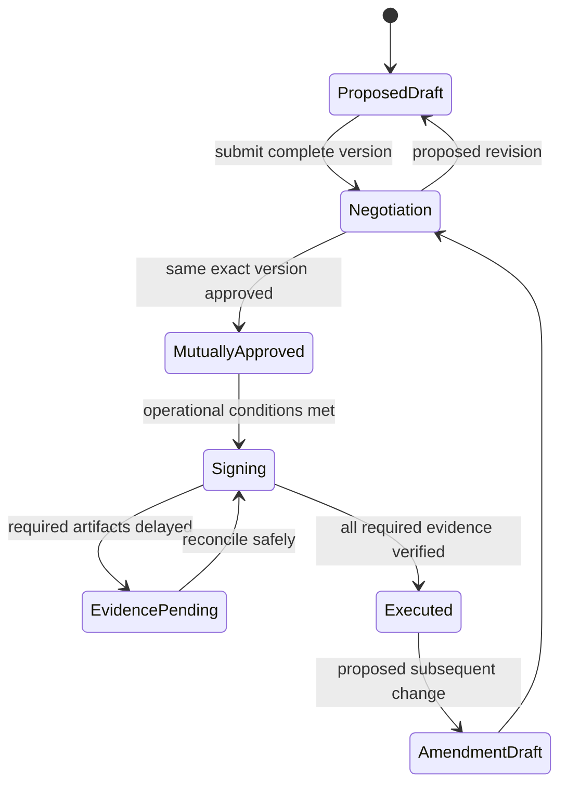
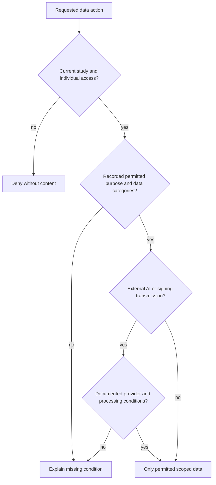
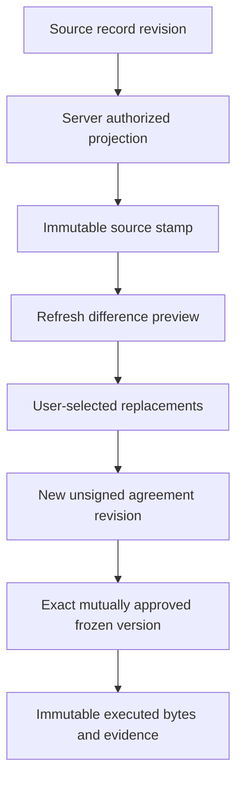

# Guided partnership agreements and researcher workspaces - Plan

## Goal Capsule

- **Objective:** The owner and a research partner can complete, negotiate and manage their study agreement and its data-use terms through the partner's private workspace, with a clear next action and a truthful signing state.
- **Means:** Extend the existing typed editor, private SQL transactions and signing boundary (KTD1–KTD6).
- **Authority:** The user's six-item continuation and instruction to work sequentially govern this companion plan. The requirements in the 18 October plan and completed 20 October intake plan remain applicable. This plan adds no production authority.
- **Execution profile:** Deliver and verify U1–U7 sequentially in the existing development branch. Read-only research may overlap. The calling agent owns final verification and local commits.
- **Stop conditions:** A live deployment, production migration, real export, real signature, real message, paid service, account/key creation or broader credential access requires separate authorization. Complete all local synthetic work first.

---

## Product Contract

### Summary

Bring the V4 guided agreement into the existing Hebrew editor, prepare a linked draft when the owner approves a partnership request, and reuse authorized study information throughout the folder. Complete the signing integration and delivery tracking behind explicit operational dependency states.

### Problem Frame

The intake now creates a private partner workspace and a draft research application, but the owner still has to start and partly re-enter an agreement. The current agreement editor covers twelve sections yet lacks explicit fields for many V4 variables and annex details. SignWell's successful test was separate from the partnership workflow and did not establish identity, signing authority or the required audit certificate.

### Requirements

**Agreement content and completion**

- R1. The twelve-section editor and structured annexes A–F cover every variable in the supplied V4 agreement and its completion instructions, without requiring Word editing.
- R2. Preserve the exact first two paragraphs of V4 section 8 as owner-approved text; all other V4 clauses remain proposed terms until the relevant approval process is completed.
- R3. A deterministic source-to-field manifest maps each body placeholder occurrence to an editable validated field, and keeps editing guidance out of the final agreement.
- R4. Every annex is either populated with its actual structured content or explicitly marked inapplicable with a reason; a proposed annex description is never presented as an attached completed annex.
- R5. Drafts autosave and resume, show incomplete decisions and allow authorized proposals; the existing exact-version mutual approvals and immutable amendments continue to govern signed terms.

**Preparation, provenance and updates**

- R6. Owner approval of an intake prepares one linked agreement draft in the same transaction as its existing partner, membership and application work; an existing folder offers the same preparation action.
- R7. Prefill reuses authorized profile, study, tools, questionnaire versions, current partner grants, approved contributions, selected budgets and recorded ethics/consent configuration, with visible source references and explicit source selection where multiple records have different meaning.
- R8. Current permissions come from that partner's current study membership, never from requested permissions or the owner's broader privileges; neither agreement creation nor editing grants access.
- R9. Refreshing source information presents exact differences and preserves explicit overrides unless selected for replacement, producing a new unsigned revision rather than changing an approved-for-signing or executed version.
- R10. The folder explains how information arrived, where to update it, who may see it and what is awaiting each party; source-data changes do not automatically replace contract terms or publish findings.

**Signing, data use and dependencies**

- R11. Integrate SignWell through the existing signing boundary while retaining DocuSign, using same-version mutual approval, explicit signing consent, signer identity and authority evidence, immutable final bytes/hash and required provider audit evidence.
- R12. Verified completion saves the signed copy privately for both parties, tracks delivery separately from provider acceptance, activates the partnership only when all research/contract conditions hold, and creates source-linked obligations for owner review.
- R13. Missing identity assurance, authority, audit certificate, compatible signature policy, delivery or provider operation leaves execution unavailable with a specific actionable explanation; a synthetic test or reading checkbox never substitutes for signing.
- R14. V4's per-study processing conditions govern each use of data: categories, purposes, party roles, authorized people, providers, storage, retention/backups, deletion and withdrawal. No universal country or retention period is invented, and personal information is not sent to external AI before the relevant documented processing conditions exist.
- R15. Server and database enforce current study and individual scope for all preparation, edits, tasks, documents, exports and reconciliation; metadata and audit access do not expose another partner's records.
- R16. Development and verification use only invented data and credentials. Signed originals, actual identity evidence, participant/health data, private communications, financial records and secret-bearing traces are excluded from fixtures, screenshots, documentation, logs, external calls and routine backup work unless their exact authorized contractual route permits the operation.
- R17. The complete workflow remains simple Hebrew RTL on desktop and mobile, including all inputs, live preview and optional PDF/Word output.

### Actors and key flows

- A1. Owner: prepares proposed terms, reviews changes, assigns explicit access, signs in her own capacity and tracks obligations.
- A2. Individual partner or institutional representative: completes authorized details, proposes amendments, supplies authority information and accesses only her authorized folder.
- A3. Existing server/SQL and configured providers: enforce boundaries and report real evidence, never infer agreement from a screen state.

- F1. Public request → owner identity/study/grant selection → atomic application and proposed agreement preparation → partner's private workspace.
- F2. Existing folder → choose relevant source records → prepare/resume agreement → complete fields/annexes → compare and negotiate → same-version approval.
- F3. Freeze approved version → consent/identity/authority checks → embedded signing → server reconciliation → immutable evidence and delivery → conditional activation and obligation review.
- F4. Source update → authorized refresh preview → select replacements → new draft/version → renewed approval where applicable; executed terms use a linked amendment.

### Acceptance examples

- AE1. An individual request is approved with only `view_study` and `view_approved_findings`; one agreement draft shows those actual grants, preserves the original request and remains nonbinding after replay.
- AE2. The owner selects a budget and contribution from partner X's study, changes a prefilled date, then refreshes after a source revision; the date override is retained until explicitly replaced, and the provenance records the selected source versions.
- AE3. Partner Y guesses X's draft, attachment, preparation receipt, export or signing session ID; every server and SQL route denies access and returns no private metadata.
- AE4. A provider reports `Completed` but lacks required audit/identity evidence, or reports `Manually completed`; the agreement remains unexecuted, with no binding obligations or partnership activation.
- AE5. The complete synthetic journey survives a failed save, a delayed provider artifact and revoked access, while final exports retain mixed Hebrew/English, dates, amounts and all selected annex content.

### Scope boundaries

This companion completes the six agreed items; it does not replace intake, authentication, the existing writing engine, consent collection, contribution accounting or research analysis. The base partnership feature was deployed on 19 October with authorization; the 20 October intake and this continuation remain local.

No live configuration changes, secret retrieval/persistence/recapture, new API keys, account creation, OAuth grants, real mail or provider calls, real exports, backup access or backup modifications are part of this work. The earlier SignWell key authorization was memory-only for a separate local experiment and grants no broader access here.

#### Deferred to Follow-Up Work

Authorized operational provider verification, institutional acceptance, real delivery validation and production release remain separate from local implementation. The requested live outcome stays in R11–R13; local completion reports the precise dependency instead of representing it as activated.

---

## Planning Contract

### Key Technical Decisions

- KTD1. **One server-only V4 catalog, the existing typed contract and scoped template records.** Import the unsigned source into a versioned server catalog, preserving twelve existing section IDs and generating proposed template instances within the existing study/partner scope. Only field vocabulary remains public; authorized clients receive their scoped proposed clauses and hints. Reuse the editor, SQL validation and exports rather than introducing a second agreement product. Governs R1–R5.
- KTD2. **Server-owned preparation and provenance.** A single private helper assembles allowed sources and creates the scoped template/agreement drafts; call it from intake approval and an owner-only preparation mutation. Store provenance in immutable server-controlled metadata or a separate preparation receipt, outside client-editable assertions. Owner legal details come only from an established authorized private source; authentication identity is not legal party data. Missing details stay available for first entry and then draft resume, without borrowing another partner's private agreement. Governs R6–R9.
- KTD3. **Explicit refresh rather than silent synchronization.** Existing record/version writes handle selected refresh replacements and negotiations; preserve the initial source snapshot and field-level override state. Show contractual permission snapshots alongside live permissions as different facts. Governs R7–R10.
- KTD4. **Reuse adapter interface without weakening evidence.** Add a SignWell v1 adapter with injected fetch/configuration, explicit provider selection and fail-closed completion. Keep the separate trial tool and DocuSign interface intact; no automatic provider fallback. Governs R11–R13.
- KTD5. **Reconcile a stored provider ID before acting.** SignWell webhook HMAC authenticates only event type/time, so a callback may only trigger bounded server reconciliation of an already stored session. Browser completion events are hints. Recover uncertain creation without blind create retries; reconcile final artifacts and delivery independently. Governs R11–R13.
- KTD6. **Route-specific data handling.** Extend the existing deterministic impact comparison and configured AI injection. Authoritative processing permission is a server-verified, owner-approved private policy record bound to study, purpose, data categories, provider and version, subject to applicable consent and ethics restrictions. Proposed clauses and unsigned amendments cannot create or expand that permission. Pre-signing document transfer has its own approved purpose and does not require an already executed agreement. Use content-free audit/task metadata and existing encryption/individual document authorization. Governs R14–R16.
- KTD7. **Backward-compatible additive migration.** Extend the shared browser/server contract and matching SQL contract in a new migration, leaving historical migrations and executed versions intact. Old agreement versions remain readable/renderable. Governs R5, R15, R17.

### V4 field coverage

The governing source is `../../outputs/agreement-guided-v4/content.json`, with its corresponding unsigned final Word artifact. Its raw SHA-256 is `73a22c07e4df4cdac9560b95a77d6284d389e21aebcdacd64acc5e24a4c325ad`: twelve sections and nineteen body placeholder occurrences. The annex A–F texts are descriptions of documents to prepare, not completed annex originals. Anchor R3's manifest to this source fingerprint and all nineteen occurrences as well as completion/guidance coverage, rather than checking a schema only against a duplicate of itself.

| Existing section | Structured coverage to retain or add | Annex |
|---|---|---|
| Parties | Legal party kind/name/registration/address/notices; signer name/role/authority basis; lead researcher, institution and contacts; institution approval when relevant | A |
| Study | ID/title/questions/method/population/size/sites/recruitment/measurement versions; stage responsibilities, dates, deliverables; school adaptation and evaluation | A |
| Tools and access | Tool/questionnaire source and version; named authorized users/actions/data/export; quotas, dates and training | B |
| Contributions | Contributor/institution, category, deliverable, milestones, acceptance, owner duties, requested/agreed payment/credit/rights, confirming version | D |
| Shared costs | Purpose/service, calculation basis, estimated amount versus cap, currency/tax, each share, payer/payee, approver, evidence and settlement date; free-tier limit handling | C |
| Professional fees | Provider/recipient, scope/output, hourly/fixed method, cap/hours, amount/currency/tax, invoices, acceptance/payment and partial-work terms | C |
| Development | School need/users/change, measurable output, performer, budget, milestones, test/acceptance, training, maintenance/support channels/hours/response and rights | A, D, F |
| Existing IP | Exact approved BE GOOD paragraphs; prior partner/institution/third-party assets; new outputs/creators/ownership or licence, modification/distribution/commercial use/term/payment/publication/credit | F |
| Privacy and ethics | Ethics references, participant/minor consent configuration; processing categories/purposes/roles/authorized people/providers/transfers/storage/retention/backups/deletion/withdrawal; incident/contact and confidential scope/duration/exceptions | E |
| Duration and termination | Start/end, notice and cure periods, suspension, handover/access closure, final settlement and surviving duties | A, E |
| Annexes and additional terms | Applicable annex content, publication review window, authorship/credit/logo consent, contacts/dispute period, document precedence, governing law/jurisdiction/liability/insurance decisions | A–F |
| Review and signing | Final version/annex references, identities and authority, signature provider/type/policy/evidence/consent, private storage, copy recipients/delivery and activation prerequisites | Agreement |

Do not turn suggested 30-day notice or 21-business-day publication examples into defaults. Keep `complete`/`guidance` text as field hints; adopted substantive terms enter the versioned agreement body explicitly. Rows representing money remain proposals until R11–R12 are satisfied.

### High-Level Technical Design

The diagrams describe the authoritative boundaries. Detailed helper names and SQL implementation remain execution decisions.

### Assumptions

The owner can select among meaningful competing application/budget sources during preparation; no arbitrary latest-record choice is treated as agreement. A catalog update creates a new proposed version and does not re-approve terms. No live assurance or delivery capability is inferred from the previous SignWell trial.

### System-Wide Impact

The additions affect the existing private RPC, browser client contract, partner-scoped versions, encrypted evidence, signing worker, mail intents and impact-provider projection. All use current authorization and the same exact-version lifecycle. Public intake remains limited to owner-published conditions; the full guided source is not a public asset. Participant consent and research activation remain independent conditions, and the writing engine is unchanged.

### Research and operational limits

`research-partnership-ui.js` currently seeds from approved applications while intake imports a draft, explaining the missing prefill. SQL template references are study/partner scoped and require an approved exact template head for complete submission. Preserve those gates through KTD1–KTD3.

Official [SignWell creation documentation](https://developers.signwell.com/reference/createdocument) states that embedded signing disables email authentication; Hebrew provider controls are not in its documented language list. [Completed PDF](https://developers.signwell.com/reference/getcompletedpdf) can include an audit page, but that is not established as the required audit certificate. [Event hash verification](https://developers.signwell.com/reference/event-hash-verification) binds type/time rather than the document payload. These facts require KTD4–KTD5 and honest R13 states; no Israeli signature-type or institutional-authority claim follows from them.

---

## Implementation Units

### U1. Shared V4 guidance, typed fields and coverage manifest

**Goal:** Make all V4 decisions and annex content representable in the existing agreement model.

**Requirements:** R1–R5, R14, R17. **Dependencies:** none.

**Files:** `app/lib/research-partnership-core.js`; new `harness/content/research-agreement-guidance-v4.json`; new schema-only `harness/migrations/20261020-guided-agreement-contract.sql`; `harness/fixtures/research-partnership-database.mjs`; new `docs/research-agreement-field-map.md`; `harness/tests/research-partnership-core.test.mjs`; `harness/tests/research-partnership-database.test.mjs`; `harness/tests/research-security.test.mjs`.

**Approach:** Add KTD1's private versioned source catalog and explicit nested field/row definitions using existing section IDs, types and validators. Update the matching static SQL contract in an additive schema-only migration and load it in isolated fixtures during this unit, keeping actual-SQL parity green. Preserve legacy fields and rendering. Separate approved IP, proposed substantive clauses and editor guidance. Bind each source placeholder occurrence to a field; include guidance-described variables and typed A–F annex content. The public intake continues to expose only explicitly published intake terms.

**Patterns to follow:** Frozen UMD/CommonJS core, existing missing-fields and comparison categories, existing deterministic renderer.

**Test scenarios:**

1. Every source body placeholder is mapped once with no unknown field and every completion instruction has field coverage.
2. Editing every field group changes the correct clause/annex output; editor hints and unadopted numeric examples never appear as executed terms.
3. Old record versions still validate/render; unknown fields, invalid dates/amounts and incomplete applicable annexes are identified.
4. Exact approved IP paragraphs remain byte-identical, while the rest stays visibly proposed.
5. The browser/server core and actual SQL field contracts are identical after the new migration, including hardened migration-operator loading.

**Verification:** Full source-to-field coverage, core/SQL parity and existing regression checks pass before dependent work; no unit hands off a broken contract tree.

### U2. Trusted preparation, provenance and atomic intake handoff

**Goal:** Prepare one scoped draft from authorized existing information without repeated entry or partial approval.

**Requirements:** R6–R9, R15. **Dependencies:** U1.

**Files:** New `harness/migrations/20261020-guided-agreements.sql`; `harness/lib/research-partnerships.mjs`; `app/lib/research-partnership-core.js`; `app/lib/research-intake-core.js`; `harness/fixtures/research-partnership-database.mjs`; `harness/tests/research-partnership-database.test.mjs`; `harness/tests/research-intake-database.test.mjs`; `harness/tests/research-intake-flow.test.mjs`; `harness/tests/research-security.test.mjs`.

**Approach:** Add KTD2's private preparation helper, narrow owner mutation and server-owned receipt. Call it inside the existing intake approval transaction after exact membership assignment. Instantiate a scoped proposed V4 template and draft agreement, reuse an exact prior preparation on replay, and preserve manually negotiated existing drafts. Query source choices through current scope; source-version references cannot be supplied as verified facts by client JSON. Add KTD6's narrow owner-approved policy record and revision/approval boundary through the existing private RPC, separate from editable contract data and credential settings.

**Execution note:** Start with actual-SQL proofs for the atomic handoff and authorization boundaries.

**Patterns to follow:** Fixed service RPC, FORCE RLS, current credential/membership checks, request receipts, expectedRevision and existing record versions.

**Test scenarios:**

1. Covers F1 / AE1. Approval creates one linked application/template/agreement and receipt with only selected current grants; identical replay adds nothing.
2. A template, source or record failure rolls back intake approval, membership and new drafts together.
3. Existing profile values are not overwritten by an untrusted public proposal; ambiguous source choices are returned for explicit selection.
4. Wrong partner/study, researcher self-approval, stale revision, forged provenance and direct browser-role SQL all fail.
5. Revocation after preparation denies subsequent reads/refresh/signing; a signed agreement is never reseeded.
6. A researcher with study-edit rights cannot create, approve or expand processing authorization; stale or revoked policy approval does not authorize a provider route.

**Verification:** Actual SQL and gateway parity pass including the hardened non-superuser migration sequence; historical migrations remain unchanged and unapplied to production.

### U3. Complete editor, source refresh and folder next actions

**Goal:** Let both parties complete and update their agreement entirely in the private RTL workspace.

**Requirements:** R1, R4–R10, R15, R17. **Dependencies:** U1, U2.

**Files:** `app/lib/research-partnership-ui.js`; `app/lib/research-intake-ui.js`; `app/lib/research-client.js`; `app/research-management.html`; `harness/tests/research-partnership-ui.test.mjs`; `harness/tests/research-partnership-refresh.test.mjs`; `harness/tests/research-intake-ui.test.mjs`.

**Approach:** Replace duplicate browser seeding with the preparation result. Render the twelve sections and A–F subforms, contextual V4 hints, applicability and completeness. Add source labels, explicit refresh comparison/selection and owner/partner next-action links. Preserve intentional empty overrides and check previewed source/agreement revisions before replacement. Show live access separately from the agreement's recorded grant snapshot. Privacy completion exposes the owner-only processing-policy review separately from each party's proposed terms. Reuse autosave serialization, cancellation and scope clearing; meaningful source choices belong in the form, not an extra administrative workflow.

**Patterns to follow:** Existing generic nested form controls, editor lifecycle, approved-version checks and folder switching.

**Test scenarios:**

1. Covers F2 / AE2. Existing folder prepares/resumes the right draft; budget/application choice and source labels are visible, and explicit overrides survive refresh.
2. Refresh makes a new unsigned version and invalidates relevant approvals; signing/executed versions offer a linked amendment instead.
3. Fields, annex applicability, missing decisions and next actions remain usable after autosave failure/retry and resume.
4. Late responses after navigation/account/study switch do not replace newer edits or expose a prior folder.
5. The approved intake links directly to its prepared draft; requested grants never appear as active grants.

**Verification:** Owner and researcher can complete, compare and propose changes without Word or duplicate data entry; UI capability matches current server permissions.

### U4. Unified Hebrew preview and real document exports

**Goal:** Render the complete selected agreement and annexes consistently on screen and in optional exports.

**Requirements:** R1–R5, R17. **Dependencies:** U1.

**Files:** `app/lib/research-partnership-core.js`; `harness/lib/research-partnership-exports.mjs`; `harness/tests/research-partnership-core.test.mjs`; `harness/tests/research-partnership-gateway.test.mjs`; `harness/tests/research-partnership-ui.test.mjs`; `docs/research-agreement-field-map.md`.

**Approach:** Use one completed document model for live preview, authorized HTML/PDF printing, DOCX and provider bytes. Include actual annex rows and referenced versions. Preserve right alignment for this agreement, bidi punctuation/numbers, safe escaping, margins and page/table continuity; maintain distinct content and byte hashes.

**Patterns to follow:** Existing OOXML paragraph bidi/right alignment, mixed-run handling and authorized export generation.

**Test scenarios:**

1. All selected clauses/annex data appear once and editing instructions are absent from the final body.
2. Hebrew, email, English tool names, Israeli dates, numeric amounts and long tables render without clipping at A4 and mobile widths.
3. Legacy agreements export unchanged; signed bytes are downloaded from immutable evidence rather than regenerated from current data.
4. Wrong scope and revoked export rights fail before content generation.

**Verification:** Inspect actual synthetic PDF and rendered DOCX pages; structural ZIP/XML checks alone do not prove visual layout. Record any unavailable rendering tool honestly.

### U5. SignWell adapter and evidence capability states

**Goal:** Connect the chosen provider protocol to the existing signing lifecycle without implying unproven assurance.

**Requirements:** R11–R13, R15–R16. **Dependencies:** U1, U4.

**Files:** New `harness/lib/research-signwell.mjs`; `harness/lib/research-signing.mjs`; `harness/lib/research-partnerships.mjs`; `harness/tests/research-signing.test.mjs`; new `harness/tests/research-signwell.test.mjs`; `docs/research-partnership-setup.md`.

**Approach:** Follow KTD4–KTD5 with invented injected credentials/fetch only. Map frozen document, expected parties, provider IDs and protected signer views. Model uncertain create, awaiting signers, artifact pending, failed verification and unavailable capability separately. Keep real initiation disabled when R13 requirements cannot be met; a generic audit page is not fabricated into a certificate. No new secret persistence path or experiment-key lookup is introduced.

**Patterns to follow:** Existing adapter start/view/refresh boundary, bounded transport, allowlisted safe projections and encrypted state/evidence handling.

**Test scenarios:**

1. Exact approved version and both parties map correctly; only the authorized party receives its view URL.
2. `Completed` is accepted only with every required independently verified evidence item; `Manually completed`, unknown status, test-mode evidence or missing certificate cannot execute.
3. Forged iframe completion, wrong provider ID/parties/hash, passcode-bearing raw response and untrusted callback data cannot become trusted state or logs.
4. Ambiguous create does not automatically create a second document; delayed/wrong-type final PDF remains recoverable and unexecuted.
5. Missing configuration, identity assurance, authority or delivery policy exposes precise dependency state and performs zero external calls in the local demo.

**Verification:** Injected protocol/evidence tests pass and DocuSign regressions remain green; documentation distinguishes implemented adapter from an operational legally accepted service.

### U6. Automatic reconciliation, delivery, obligations and data-route enforcement

**Goal:** Finish the digital workflow and its next-action tracking without manual document handling.

**Requirements:** R10–R16. **Dependencies:** U2, U5.

**Files:** `harness/lib/research-partnerships.mjs`; `harness/lib/research-signing.mjs`; `harness/lib/research-mail.mjs` where shared patterns are reused; `harness/practice-server.mjs`; new guided-agreement migration from U2; `app/lib/research-partnership-ui.js`; `harness/tests/research-partnership-gateway.test.mjs`; `harness/tests/research-partnership-flow.test.mjs`; `harness/tests/research-security.test.mjs`.

**Approach:** Extend the existing server-owned signing-worker pattern so authorized reconciliation and copy availability/delivery can finish independently of an open browser. Persist version-bound delivery states and retryable intents, with current recipient authorization before sending and content-free failures. Preserve existing obligation extraction/review and conditional activation. Apply KTD6 to external impact analysis and provider/document routes, while keeping deterministic comparison available when AI transmission is not permitted. Reuse mail leasing/idempotency patterns without misclassifying partner notices as participant recruitment.

**Test scenarios:**

1. Covers F3 / AE4. Verified synthetic completion stores immutable final/audit bytes, exposes each party's private copy, creates reviewable obligations and respects research activation prerequisites.
2. A duplicate or delayed callback/reconcile reuses stored provider ID and evidence; browser closure does not require manual upload or repeated signing.
3. Accepted mail, confirmed delivery, bounce, unavailable delivery evidence and private-folder availability remain distinct; a failed send is retryable without re-execution.
4. No unsigned proposal or amendment creates binding obligations; later signed amendment retains original source links.
5. Personal or confidential changes lacking documented external-AI processing conditions never reach the injected provider; permitted minimal changes do, and model failure preserves exact comparison.
6. Missing purpose/provider/authorized-recipient conditions or revoked scope blocks reads/transfers/exports/tasks without exposing content.
7. A partner proposes permissive provider clauses and requests AI impact analysis; the provider receives nothing without KTD6's independent authorization. An authorized pre-signing transfer succeeds without treating the draft as already executed.

**Verification:** Actual SQL and HTTP workflow proves state transitions; synthetic adapters never contact providers, send messages or claim live delivery. Operational worker scheduling remains an explicit configuration prerequisite before live use.

### U7. Full journey verification and owner-facing completion notes

**Goal:** Deliver the finished local workflow with reproducible evidence and clear operational boundaries.

**Requirements:** R1–R17. **Dependencies:** U1–U6.

**Files:** `harness/research-partnership-browser-server.mjs`; `harness/research-intake-browser-check.mjs`; `harness/tests/research-partnership-flow.test.mjs`; `harness/tests/research-intake-flow.test.mjs`; `harness/tests/research-security.test.mjs`; `docs/research-partnership-setup.md`; `docs/research-partnership-api-contract.md`; new `docs/verification/2026-10-20-guided-agreements.md`.

**Approach:** Extend the existing isolated browser fixture and real SQL/HTTP integration rather than mock only UI success. Exercise the private researcher journey and owner tasks using invented identities/content. Update stale deployment/readiness notes, record exact evidence limits and clean abandoned implementation attempts.

**Test scenarios:**

1. Covers F1–F4 / AE1–AE5. Request → owner approval → linked proposed agreement → source selection/completion → negotiation → both approvals → synthetic signing/evidence/delivery → obligations → amendment.
2. Two partners in different studies and in the same study cannot enumerate or access each other's agreements, source receipts, tasks, files, exports or signing URLs.
3. Revocation/password changes fail subsequent URL/API/worker/export access, including restoration of a stale browser tab.
4. Desktop/mobile RTL and actual PDF/DOCX visual review cover long annex tables, punctuation, mixed direction and keyboard/focus behavior.
5. Existing intake, research, consent, writing, auth, backup-monitoring and signing tests continue to pass without contacting live infrastructure.

**Verification:** All meaningful automated checks pass, browser journeys have no errors/overflow, review findings are resolved and the local release note differentiates development completion from external activation.

---

## Verification Contract

Run focused Node `--test` files named in each unit, then the complete `node --test` suite from `harness` with the configured isolated PGlite module so actual-SQL tests do not silently skip. The package defines no lint or typecheck script. Include the hardened migration-operator path and full API/core/SQL contract parity.

Use the existing local browser server and Playwright checks against fresh synthetic fixtures on desktop and mobile. For document layout, follow the documents/PDF rendering workflow and inspect generated pages, not screenshots of private originals. No real provider/API/mail/AI calls or protected data become test material under R16.

Before local delivery, simplify and review the changed implementation, resolve valid findings, then rerun the affected and complete checks as warranted. Do not represent PGlite's single connection as proof of hosted PostgreSQL concurrency or mocked evidence as operational signature verification.

---

## Definition of Done

The owner can demonstrate F1–F4 entirely inside the local application, all V4 placeholders and annex decisions have mapped fields, and an approved intake yields one nonbinding agreement draft with trusted source references. Both parties can complete and propose changes without opening a document editor.

Every feature-bearing unit's tests and verification outcome pass, existing functionality remains intact, and all source/evidence permissions are enforced in both server and SQL. The final preview/export includes exactly the selected agreement and annex content, and signed versions remain immutable.

The SignWell integration is proven synthetically, with exact unmet operational identity/authority/certificate/delivery/policy prerequisites disclosed and real execution blocked accordingly. Local commits and unapplied migrations preserve version history; no production release or credential access is implied.

Remove abandoned experiments and unused implementation paths. Documentation contains no real secrets or protected records and gives the owner a short Hebrew explanation of what was completed, how she updates a folder and which external steps remain.
