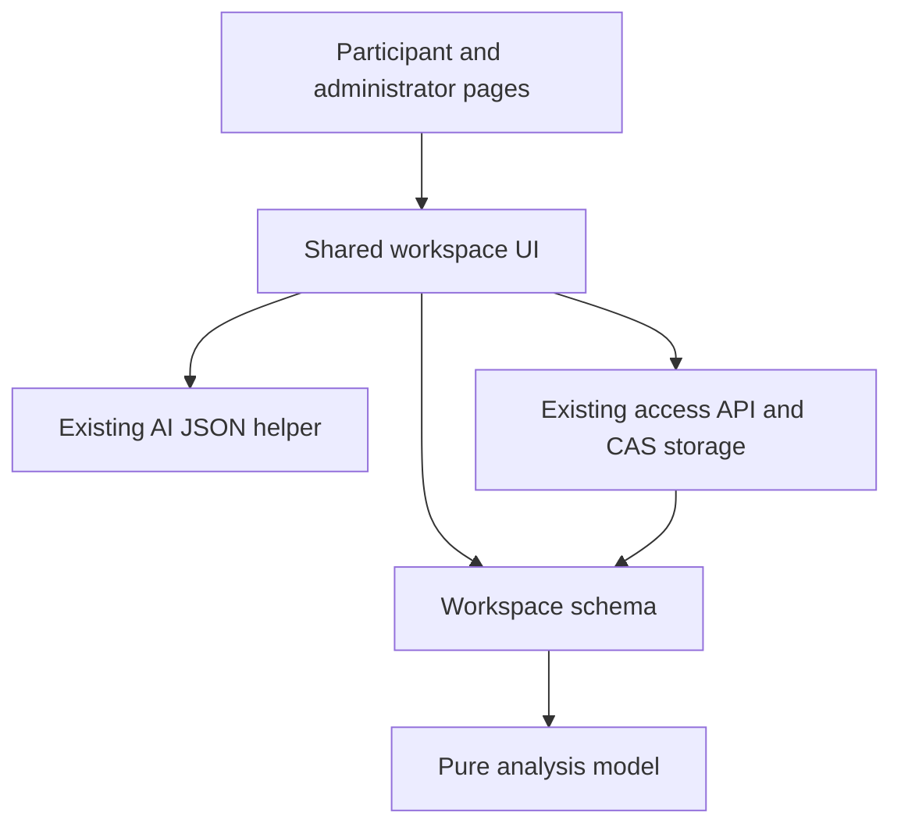
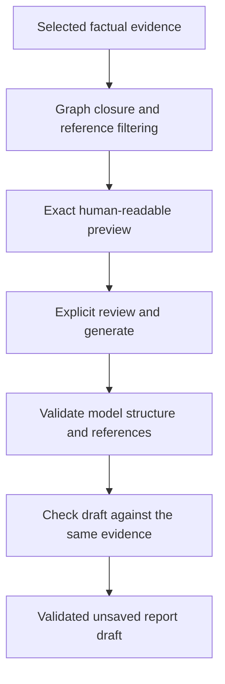
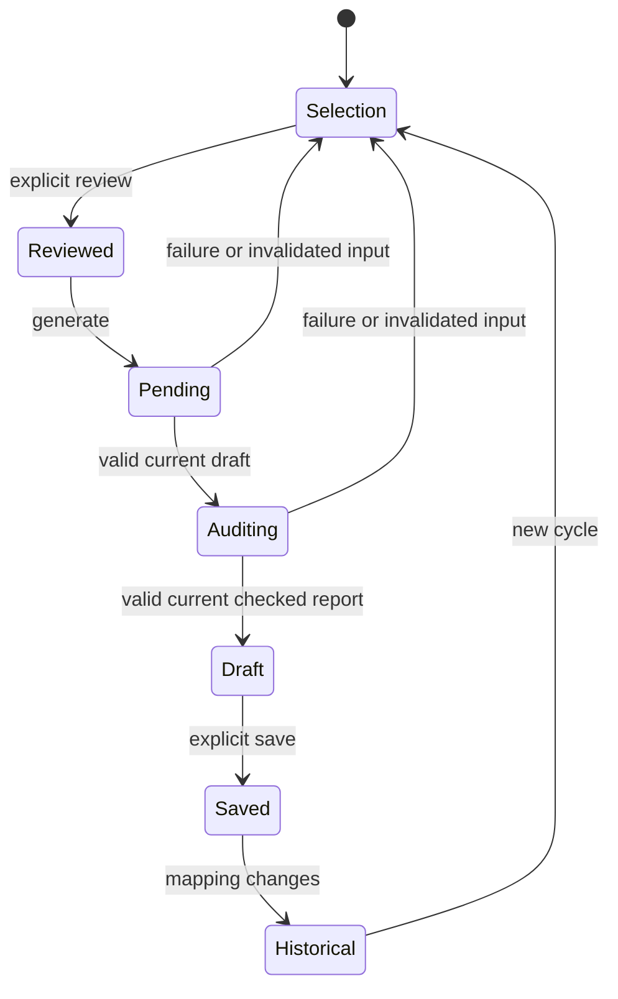
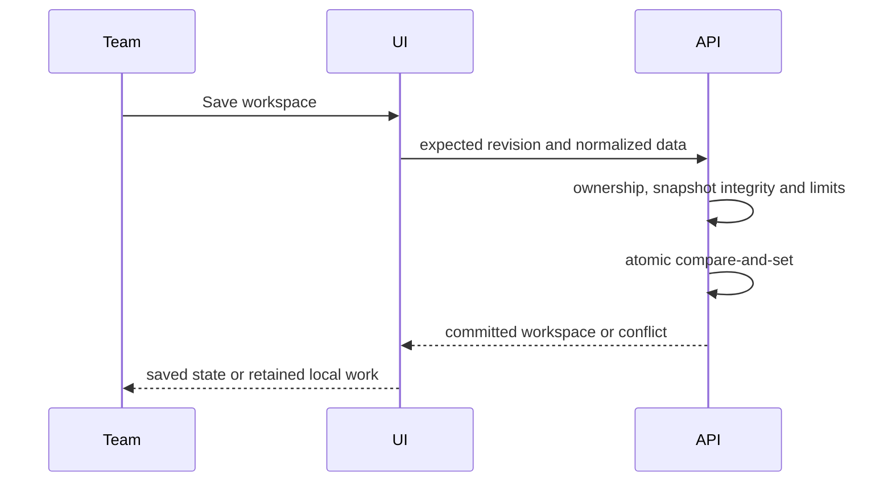
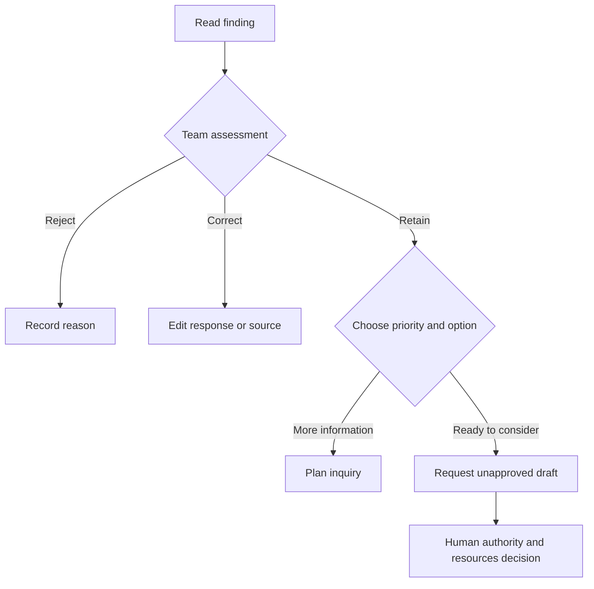
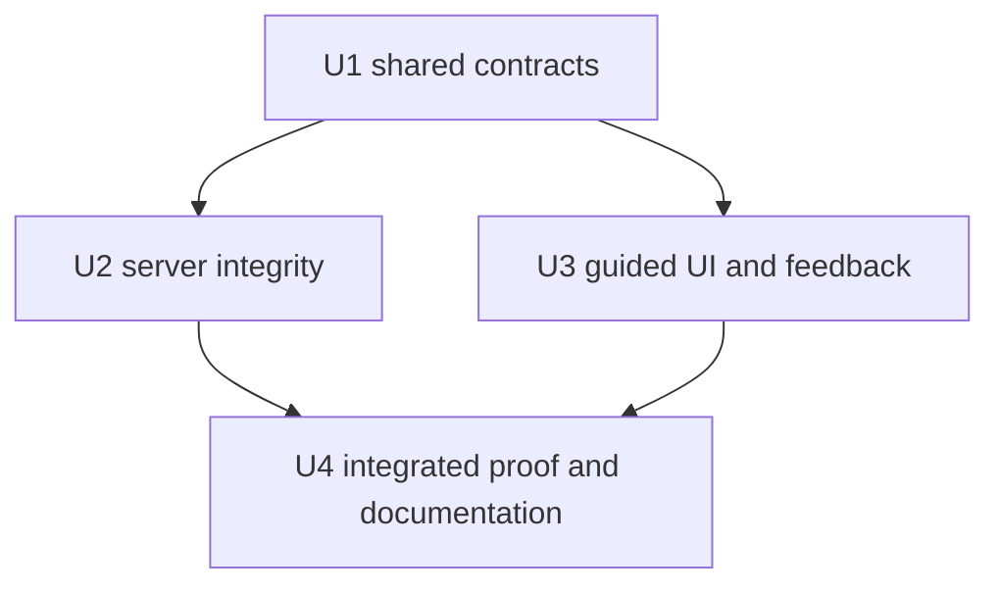

# Resilience Journey Evidence and Feedback - Plan

## Goal Capsule

- **Objective:** School and community teams can understand what their mapping supports, discuss competing explanations, and choose feasible actions whose effects they can revisit.
- **Means:** Extend the existing shared workspace and reviewed AI flow through KTD1–KTD6.
- **Authority:** User requirements and current session decisions govern product behavior; repository instructions govern implementation and publication.
- **Execution profile:** Local implementation, meaningful tests, browser verification, simplification and code review; the calling workflow owns execution and handoff.
- **Stop conditions:** A requirement cannot be met without destructive migration, unapproved external transfer, changed ownership rights, or deployment.

---
## Product Contract

### Summary

Upgrade the whole resilience journey from long record forms and short AI suggestions into guided evidence collection, interpretable feedback, team deliberation, action planning and repeated learning.
Apply the same conceptual model to schools and communities with examples and responsibilities suited to each setting.

### Problem Frame

The present workspace captures the four inventories and network links, but teams must infer how to deepen the mapping and how to interpret it.
Its AI output contains only a title, category, evidence references, interpretation and uncertainty.
This leaves observations, competing explanations, practical options and human priority choices insufficiently connected.
The current input builder can omit the endpoint mechanisms of a selected network link, weakening interpretation of that link.

### Key Decisions

- **Summary with expandable detail** (session-settled: user-directed — chosen over a detailed-only or summary-only report: teams need a clear entry point with access to the underlying reasoning). Governs R6.
- **Both school and community journeys:** The user's correction requires both organizational settings throughout the process. Governs R1.

### Requirements

**Guided collection**

- R1. Each new workspace provides a continuous process appropriate to its selected setting, including school staff empowerment or community representation and volunteer capacity as applicable.
- R2. Collect the population and groups in scope, mapping period, participants and missing voices, initial situation, mandate and delegated responsibilities before interpreting findings.
- R3. Retain four distinct inventories: roleholders, social mechanisms, supporting infrastructures and additional resources, with record knowledge state and dated update provenance.
- R4. Deepen selected mechanisms with actual-use examples, contrasting accounts and directed network links whose conditions, operators, dependencies, barriers and alternatives can be examined.

**Evidence and feedback**

- R5. AI receives only factual information selected and reviewed by the team, including the context needed to understand referenced entities; prior AI output is never evidence.
- R6. Present a concise team summary first, with expandable evidence, observations versus interpretation, contradictory accounts, alternatives, uncertainty, missing information and practical options.
- R7. Distinguish absence, incomplete realization, unexamined information and conflicting accounts; show present quality of life and future preparedness separately.
- R8. Findings and recommendations refer only to evidence and entities contained in the reviewed input; a second consistency pass checks the draft against that input before feedback is offered.
- R9. Offer one to three reasoned priorities only when supported, with feasible alternatives and their conditions; a limited record can justify further inquiry or deferral rather than an action recommendation.

**Team action and learning**

- R10. The team can accept, edit or reject interpretations, record priority reasons and dissent, and explicitly request unapproved decision or action drafts.
- R11. Action planning records authority, responsibility, partners, time, resources, backup, what is reduced to make room, and a date and evidence for review.
- R12. Save each analysis with its exact reviewed input and validated output, so the team can inspect an earlier report and compare factual changes in a later learning cycle; allow explicit deletion of a selected report for privacy correction.

**Preservation and limits**

- R13. Preserve existing legacy journeys and workspace records without silent conversion, and retain live ownership, institution checks, atomic revision checks and unsaved-work protections.
- R14. Preserve the supplied social-mechanism definition and conceptual distinctions, including seven action principles separate from seven quality dimensions and three parallel lenses: קיום, מימוש והתחדשות.
  The four orienting properties are shared commitment, distributed responsibility, use of mechanisms with examination and improvement, and continuing learning; they are not validated scores.
  Multichannel resilience consciousness concerns individual, family, peer, school, community and authority contexts and can itself organize expectations and action; it is not merely communication through several channels.
- R15. The journey supports development and self-evaluation, without resilience scores, invented data, causal guarantees, validated measurement claims or automatic external certification.

### Key Flows

- F1. **Guided mapping:** מסגרת ושותפים → ארבעת המיפויים → העמקה במנגנון ובמקרה ממשי → בחינת רשת המנגנונים. Covers R1–R4.
- F2. **Interpretation meeting:** בחירת מידע ועיון בו → בקשת ניתוח → תמצית והרחבה → תיקון, דיון וחלופות → החלטה אנושית. Covers R5–R10.
- F3. **Learning cycle:** תכנית פעולה → איסוף ראיות חדשות → בחירת תמונת מצב קודמת → השוואה ולמידה → עדכון. Covers R11–R12.

### Acceptance Examples

- AE1. A selected observed information link includes both endpoint mechanisms in the preview even when only the link has the selected evidence; it does not import unrelated evidence. Covers R5.
- AE2. A school records a formal mentoring procedure and no observed use; feedback treats operation as unexamined and does not call the procedure effective. Covers R7–R8.
- AE3. Community volunteers describe several channels that share one coordinator; feedback may raise shared dependency but cannot assert independent backup. Covers R1, R6–R8.
- AE4. A team rejects a finding and selects another priority; nothing becomes an approved decision or assigned action without its explicit input. Covers R10–R11.
- AE5. Mapping changes after an analysis was saved; its original input remains inspectable and a later comparison labels context and period differences. Covers R12.

### Scope Boundaries

Local product changes cover input, analysis, feedback, deliberation, planning, learning, print/export and documentation.
New workspace journeys are the canonical new process; legacy pages show a previous-format explanation and a way to start a new journey without modifying the old record.
Existing owner-code and administrator access remains the access model.

#### Deferred to Follow-Up Work

- Separate personal staff permissions and multi-user collaboration require their own authorization design.
- Detailed measurement instruments, field validation and the external certification application process require later development.
- File upload, OCR and automatic source-document extraction remain separate from entering an approved evidence summary.

#### Considered and Not Built

- A new database or independent snapshot API is unnecessary for the bounded journey history in KTD4; reconsider only when actual storage needs exceed that contract.
- Automatic ranking, causal attribution, approval and task assignment would displace the deliberation required by R10 and R15.
- Silent truncation and invented offline model reports would obscure missing information; reject oversize or invalid data visibly instead.

---
## Planning Contract

### Assumptions

- Six grouped steps reduce initial form burden while keeping deeper fields reachable; this is an implementation hypothesis to check with realistic browser scenarios, not a proven adoption outcome.
- No new dependency or external research is needed because the shared model, generic record UI, CAS persistence and reviewed JSON model helper already establish the required local patterns.
- Deterministic input comparison is sufficient for the first learning-cycle implementation; it describes change without claiming what caused it.

### Key Technical Decisions

- KTD1. **Extend the current shared model.** Keep additive optional fields and empty defaults in `app/lib/journey-workspace-model.js`; use a separate `analyses` collection rather than forcing report objects into generic record fields. Implements R2–R4 and R12–R14.
- KTD2. **One pure analysis module.** Add `app/lib/journey-analysis-model.js`, exposed as `SBE_JOURNEY_ANALYSIS` in browsers and CommonJS in tests/server; it owns input closure, report validation, snapshot normalization, comparison, requested draft construction and both AI prompts. It does not import the workspace module, avoiding a dependency cycle. Explicit factual-field allowlists define the input projection; the workspace model retains its existing AI prompt export as an alias of the new report prompt.
- KTD3. **Reviewed graph closure.** Seed the input from selected evidence and directly associated inventory/link records, add link endpoints and each included mechanism's linked roles, infrastructures and resources, then strip `roles.person` and filter all evidence references to the selection. Label contextual inclusion in the preview and include selected-versus-total coverage, mandate and delegation. Implements R5 and R8.
- KTD4. **Bounded immutable analysis history.** Preserve the existing 400,000-byte base journey limit after excluding `workspace.analyses`, allow at most 20 analyses and 1,800,000 UTF-8 bytes for the complete journey, and reject excess without truncation. Keep the current API body limit with envelope headroom. Retained analysis id, creation time, source revision, baseline, input and output are immutable at `jrSaveWorkspace`; team responses remain editable. A removal requires the exact removed ids in `body.removedAnalysisIds`, queued by explicit UI confirmation until the CAS save succeeds. Whole-journey deletion remains available. Implements R12–R13.
- KTD5. **Snapshot-relative references.** Validate saved reports against their saved input, not the changing current inventories. Baseline references may survive an explicitly deleted report and then display as unavailable; comparison never recursively embeds prior analysis output. Membership differences mean inclusion or exclusion from the reviewed snapshot, not factual creation or removal; show selection and coverage changes before interpreting differences. Implements R8 and R12.
- KTD6. **Two-pass reviewed analysis.** Keep `sbeCallAIJson`, its validated targeted retry and `customerReview:true` on both calls: generate a draft, then check the same reviewed input plus the clearly labelled non-evidence draft using `AUDIT_SYSTEM`, returning the same report schema. Revalidate the final report and offer none if either pass fails. Existing serial/revision/generation guards apply before the second call and before displaying output. Keep preview review, generation, snapshot-save and draft creation separate human actions. Implements R5, R8, R10 and R13.

### High-Level Technical Design

Component ownership:

Reviewed input flow:

Analysis lifecycle:

Save protocol:

Human decision branches:

Unit dependencies:

### System-Wide Impact and Risks

The participant and administrator surfaces mount the same UI, so both must load the new module in the same order and preserve their navigation guards.
Free text can still contain personal information after the dedicated name field is removed; the exact preview and affirmative review remain necessary.
Structural reference validation cannot prove the truth of a model's interpretation; the interface must preserve the team's ability to question and reject it.
Stored snapshots contain historical factual input, with explicit selected-report or whole-journey deletion under KTD4.
The consistency pass adds latency and can catch mismatches, but does not constitute independent model review or establish empirical validity.
The present per-code access model does not establish separate permissions for organizational roles entered in the forms.

### Sources and Existing Patterns

- `docs/resilience-workspace.md`: current domain boundaries, server storage and legacy separation.
- `app/lib/journey-workspace-model.js`: allowlisted fields, stable record ids and reference validation.
- `app/lib/journey-workspace.js`: generic record forms, reviewed input, delayed-response guards and explicit save.
- `harness/lib/access.mjs`: live owner/institution checks, `jrSaveWorkspace`, metadata CAS and size enforcement.
- `harness/tests/journey-workspace-model.test.mjs` and `harness/tests/journey-workspace-backend.test.mjs`: current compatibility and ownership fixtures.
- `app/journey.html`, `app/journeys.html`, `app/lib/ai-call.js` and `app/lib/product-doc.js`: shared mounting, model retries and printable output.

---
## Implementation Units

### U1. Shared evidence and analysis contracts

**Goal:** Make guided input and analytical reports validatable using one browser/server contract.
**Requirements:** R2–R9, R12–R15; AE1–AE3, AE5. **Dependencies:** None.
**Files:** `app/lib/journey-workspace-model.js`, new `app/lib/journey-analysis-model.js`, `harness/tests/journey-workspace-model.test.mjs`, new `harness/tests/journey-analysis-model.test.mjs`, optional shared synthetic fixture `harness/fixtures/journey-analysis.mjs`.
**Approach:** Implement KTD1–KTD3 and KTD5 using the contract appendix; maintain existing exports for current consumers.
**Patterns:** UMD factory, allowlisted keys, bounded arrays/text, globally unique base record ids and typed reference validation.
**Execution note:** Establish meaningful pure-model contract tests before wiring UI or server behavior.
**Test scenarios:**
1. Existing empty and populated workspaces normalize without losing their current fields.
2. A selected link pulls in its endpoints and related resources while unselected evidence and dedicated person names remain absent. Covers AE1.
3. Unknown evidence/entity/finding references, extra keys, malformed dates and excessive arrays are rejected without truncation.
4. Unknown, absent and conflicting source states remain distinct; a formal-only mechanism does not become demonstrated operation. Covers AE2.
5. Shared-coordinator backup and missing voice cases remain explicit in synthetic report fixtures. Covers AE3.
6. Historical input compares inclusion, exclusion and changed descriptions without requiring current entities or treating prior output as evidence; changing selection alone cannot claim factual creation or removal. Covers AE5.
7. Requested decision/action drafts carry provenance but no approved person, authority or invented assigned name.
**Verification:** Model tests cover real contract boundaries and both unit kinds; no product fixture is represented as a model-generated approved result.

### U2. Persistent snapshot integrity

**Goal:** Retain trustworthy prior reports without weakening existing storage or access protections.
**Requirements:** R8, R12–R13; AE5. **Dependencies:** U1.
**Files:** `harness/lib/access.mjs`, `harness/tests/journey-workspace-backend.test.mjs`.
**Approach:** Apply KTD4–KTD5 during normalization and before the existing atomic commit, including metadata patches that pass through the common size gate.
**Patterns:** Existing live owner checks, current institution scope, strict response structure and `compareSet` revision ownership.
**Test scenarios:**
1. New snapshot save and retrieval preserve the exact reviewed input/output; a response update succeeds.
2. Mutation or undeclared removal of a retained snapshot fails; exact declared removal and adding a later snapshot succeed.
3. Changing current inventory does not rewrite or invalidate the earlier snapshot's historical entity references. Covers AE5.
4. Base content exceeding 400,000 bytes still fails; report count or complete-record budget excess also fails with no storage mutation.
5. Competing saves retain one CAS winner; metadata post/save ordering keeps snapshots and dirty local work intact.
6. Revoked, expired, wrong-institution and wrong-owner callers cannot access snapshots; deleting one report does not corrupt surviving baselines, and whole-journey deletion removes all reports.
**Verification:** Existing legacy, size, live authorization and concurrency tests pass alongside the new snapshot invariants.

### U3. Guided journey and interpretable feedback

**Goal:** Turn the shared workspace into an understandable path from mapping to collective choice and review.
**Requirements:** R1–R15; AE1–AE5. **Dependencies:** U1; server persistence integrates after U2.
**Files:** `app/lib/journey-workspace.js`, `app/lib/journey-workspace.css`, new `app/lib/journey-feedback.js`, `app/journey.html`, `app/journeys.html`, new `harness/tests/journey-workspace-ui.test.mjs`.
**Approach:** Group the existing record editors into six steps: context; four inventories; mechanism and evidence depth; network; analysis and team discussion; action and learning.
Keep essential fields visible first and optional depth expandable, retaining direct access to existing records.
Implement the R6 view, KTD6 lifecycle and explicit draft actions with no preselected approval or priority; require the team's priority reason before making a decision draft.
Show saved reports independently of current AI selection, including their date/period and an outdated-input indicator.
Provide an explicit baseline selector and deterministic factual comparison before the next cycle.
**Patterns:** Existing safe text DOM construction, shared mount, `SBE_DOC`, dirty/conflict guards, generation tokens and tested metadata acknowledgement ordering.
**Test scenarios:**
1. School and community users complete the six-step flow with appropriate language, different examples and common concepts.
2. Preview includes every field actually sent, including coverage counts, selected ids and contextual closure records; no model call occurs before both review and Generate. Covers AE1.
3. Summary opens with at most three key findings; details expose source, contradictions, alternatives and uncertainty without scoring.
4. Reject/edit/accept and priority discussion do not approve decisions; draft creation requires explicit option selection. Covers AE4.
5. Delayed AI after edits, deselection, review revocation, route change or unmount cannot install stale results or begin the audit call; invalid audit output produces no finished feedback.
6. Saved historic reports survive mapping changes and open with their own evidence; new-cycle comparison names period/context changes. Covers AE5.
7. Failed, timed-out or conflicting saves preserve input and retry/export opportunities; keyboard/mobile navigation and print remain usable.
8. A legacy journey remains readable with its previous-format notice and no silent migration; cancelled report deletion changes nothing and reload clears queued deletion ids.
**Verification:** Participant/admin and school/community surfaces work at desktop/mobile widths with synthetic API/model responses, without overflow or unhandled errors.

### U4. Integrated acceptance and documentation

**Goal:** Establish the full local workflow and accurately document its capabilities and limits.
**Requirements:** R1–R15; F1–F3, AE1–AE5. **Dependencies:** U2 and U3.
**Files:** `docs/resilience-workspace.md`, the U1–U3 test files, `harness/tests/journey-workspace-ui.test.mjs`.
**Approach:** Document the new six-step flow, evidence selection, graph closure, report history, human deliberation and truthful limitations; remove obsolete claims in place.
**Test scenarios:**
1. A school case follows mapping → reviewed input → report → human response → unapproved draft → action/review → later comparison.
2. A community case follows the same process with missing voices, volunteer capacity and municipal boundaries.
3. Both mounting pages retain old navigation, save/metadata ordering and print/export behavior with saved analyses.
**Verification:** Full relevant harness passes; final rendered screens and printable reports are inspected; live hosted model availability remains unverified unless actually exercised with authorization.

---
## Verification Contract

The existing Node harness (`harness/tests/*.test.mjs`) is the regression baseline; run applicable model/backend tests and the complete harness after integration.
Use actual participant/admin HTML with a synthetic access API and model reply for browser acceptance at 1280px and 390px.
Include delayed responses and both post/save reply orders in the existing lifecycle proof rather than replacing them with source-string assertions.
Inspect printed summary/detail/history output and verify RTL, no clipped controls, visible uncertainty and no generated certification.
Repository publication gates still apply; this local task does not authorize upload, PR, merge or deployment.

---
## Definition of Done

All R-IDs have verified behavior or an explicit scoped limitation, and AE1–AE5 are demonstrated.
Existing legacy data, access boundaries, size enforcement and data-loss protections remain intact.
Both settings support a complete path through collection, feedback, discussion, plan and repeated learning.
The final report identifies what was tested locally and what remains unverified in the hosted environment.
Abandoned experiments, dead code and temporary production fixtures are removed; documentation describes the final implementation.

---
## Appendix

### Shared Interface Decisions

`SBE_JOURNEY_ANALYSIS` owns `buildInput`, `validateReport`, `cleanAnalysis`, `compareInputs`, `draftFromPriority`, `AI_SYSTEM` and `AUDIT_SYSTEM`; final helper signatures may follow the existing code style.
Load the analysis module before the workspace schema in both browser pages; the schema can depend on it, never the reverse.
Keep `analyses` outside `SECTIONS` and handle it through its own strict validator.

### Additive Input Fields

- Context: `population`, `groups`, `periodStart`, `periodEnd`, `participants`, `missingVoices`, `baseline`, `baselineAt`.
- Inventory provenance: `knowledgeState` (`unknown`, `unexamined`, `present`, `partial`, `absent`, `conflicting`), `updatedBy`, `updatedAt`.
- Evidence: `kind`, `method`, `voices`, `missingVoices`, `caseContext`, `caseTrigger`, `caseAction`, `caseResult` supplement existing source/date/details/limits.
- Links: `conditions`, `operators`, `actualFlow`, `sharedDependency`, `barriers`, `alternative`, `alternativeAvailability` supplement source/target/type/status.

### Report and Snapshot Shape

All text retains the shared 4,000-character ceiling; every nested object and list uses explicit allowed keys and limits.
The report has `summary`, up to eight `findings`, eight `network` concerns, eight `missingInformation` items and three `priorities`.
`summary` contains `overview`, at most three `keyFindingIds` and `limits`.
A finding has stable `id`, `title`, `kind`, `observation`, `interpretation`, `evidenceIds`, `contradictingEvidenceIds`, `entityRefs`, `alternativeExplanations`, `uncertainty`, `presentImplication`, `futureImplication` and relevant `lenses`.
A network concern has `title`, `concern`, `entityRefs`, `evidenceIds` and `uncertainty`; a missing-information item has `question`, `why`, `entityRefs` and `evidenceIds`.
A priority has `id`, `title`, `findingIds`, `evidenceIds`, `entityRefs`, `whyNow`, `criteria`, `uncertainty` and up to three `options`.
Each option has `id`, `kind` (`preserve`, `verify`, `trial`, `change`, `defer`), `title`, `rationale`, `conditions`, `costs`, `firstStep`, `suggestedRoles` and `resources`; offer at least two options for a priority containing an action kind, or frame inquiry/deferral explicitly under R9.
An entity reference is a section/id pair from the actual reviewed input; evidence references must come from the selected evidence, and summary/priority references must target that report's findings.
The structural validator checks references and shape, while the prompt and human review retain responsibility for interpreting the evidence honestly.
A saved analysis contains `id`, `createdAt`, `sourceRevision`, optional `baselineId`, exact `input`, validated `output`, and at most twenty `responses`.
A response targets a `findingId` and records `state` (`draft`, `accepted`, `edited`, `rejected`), `comment`, `priorityReason`, `disagreement`, `reviewedBy` and `reviewedAt`.
Coverage counts belong to factual input and are descriptive rather than scores; no recursive history is embedded in model input.
