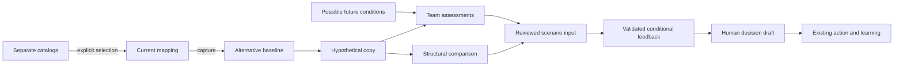
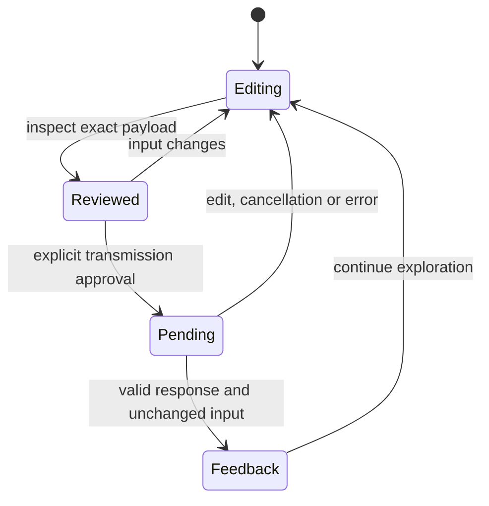

# Social Resilience Network - Plan

## Goal Capsule

School and community teams can begin their own mapping from appropriate catalogs, examine proposed network changes against several possible futures, and carry a reasoned choice into their existing work plan.

Means: extend the shared workspace and its current save contract (KTD1–KTD4). The user-approved frozen v1.3 requirements govern terminology and behavior. Source: project artifact `outputs/resilience_baseline_v1_3_2026-10-27`, outside this repository. This plan binds that source; it does not revise the frozen documents. Root owns integration, verification and local commits. Publication remains subject to the repository's explicit publication instruction.

---
## Product Contract

### Problem Frame

The published workspace supports four inventories and evidence-based discussion, but teams begin with blank inventories. It does not yet offer a persisted hypothetical network or comparison across futures. The new features connect these missing activities to the existing journey.

### Requirements

#### Starting a mapping

- R1. The visible name is רשת החוסן החברתי. The journey remains included within it.
- R2. School and community have separate catalogs for roles, mechanisms, infrastructure and resources. Selecting a candidate adds an editable local record. Unticked candidates remain unexamined. Selection records team-reported existence, date and template provenance; it establishes neither quality nor observed function. Include local names, multiple occurrences and custom items.
- R3. Mechanism details retain the approved definition, parallel existence/realization/renewal lenses, ordinary social value, hidden functions, external connections, ethos, regulations, communication arrangements, multichannel awareness and proactive learning. Add separate qualitative dimensions for use, overlap, repetition, need fit, load/capacity, dependency/backup and dated trend basis. These dimensions may coexist and are not a score.

#### Exploring change and futures

- R4. Teams create named alternatives from the mapped network, edit a hypothetical copy and add, change, pause or remove mechanisms, links, roles, infrastructure and resources. Baseline mapping is unchanged. Show comparison and effects on recorded connections, dependencies and support. A pause preserves the arrangement in the copy; removal removes it from the proposed copy with visible consequential disconnections. Neither proves loss of social function or lack of substitutes.
- R5. Possible future conditions are separate from action alternatives and the desired goal. Each has horizon, conditions, assumptions, sources, affected groups and early signs. Each alternative can be examined against every future, recording present benefits, future implications, tensions, required support, preparation, uncertainty and revisit date. Unfilled cells are explicit open inquiries, without probabilities or resilience scores.
- R6. Structural results identify direct changes only. Conditional consequences and hypotheses carry assumptions, provenance and inquiry questions. Shared support/dependency, paused endpoints, lost ties and unlinked new mechanisms are discussion signals, not automatic diagnoses. Infrastructure suggestions explain the relevant mechanism requirements and available support; the team confirms any connection.
- R7. Scenario AI input is explicitly reviewed and separate from factual evidence analysis. It includes hypothetical records even without evidence. The response is summary first, expandable detailed reasoning, distinguishes direct findings/conditional implications/hypotheses and refers only to supplied IDs. It never promotes proposals into observed facts or approves a decision. Edits while a request is running prevent the stale result from being attached. Errors preserve local work.

#### Continuity

- R8. Catalog selections, futures, alternatives and team assessments persist with current authorization, revision checks and size limits. Legacy workspaces normalize additively. Print/export include the new material, labels and original reviewed scenario feedback. Leave guards include pending scenario requests. Historical feedback remains identifiable after edits.
- R9. A team can prepare an editable draft decision from an alternative, including rationale, uncertainty and review date. Human approval remains explicit. Existing action and learning records remain the continuation path. No automatic certification, empirical prediction or compulsory school pilot.

### Acceptance Examples

- AE1. Covers R2: showing a school catalog changes no data. Selecting peer learning creates one local editable record with team-reported provenance. A community catalog instead offers locally appropriate civic/association arrangements.
- AE2. Covers R4/R6: removing a communication arrangement in a proposal visibly removes its incident ties from that proposal. The baseline still contains the arrangement and ties. Suspending it preserves its record and explains that its ties are inactive under that assumption.
- AE3. Covers R5/R7: one proposed learning circle can be examined under expanded participation and reduced available time. Neither future is assumed likely. The reviewed scenario input retains the proposed circle without evidence and is excluded from ordinary factual analysis.
- AE4. Covers R8/R9: save/reload preserves assessments and old reviewed feedback. A baseline edit marks the captured alternative as based on an earlier map. Drafting a decision does not fill human approval.

---
## Planning Contract

### Key Technical Decisions

- KTD1. Keep the current UMD/plain DOM architecture. A catalog module supplies candidate data only. Catalog provenance is an additive schema field on the four inventories. No new dependency or service.
- KTD2. Add a dedicated network model and `workspace.lab`. Each alternative captures a cleaned baseline map and a separate cleaned proposed map, plus inactive IDs and assessments. Include evidence to preserve valid references. Reuse workspace schema validation via a bounded map-clean callback; never recurse through lab snapshots. Deletion strips references and incident links only in the proposed map and the comparison exposes those changes. Frozen copies trade some storage space for reproducible comparisons; the existing save budget remains enforced and errors remain visible.
- KTD3. Reuse existing workspace save/export/print and AI completion callbacks. Network UI has lifecycle methods for pending work/cancellation; parent changes invalidate requests. Scenario feedback has its exact reviewed input and timestamp, separate from ordinary analysis history. Validate stored feedback and referenced IDs on both browser and server. No backend route is added.
- KTD4. Keep scenario UI in a separate module, using the existing field renderer for proposed map records with an explicit data source and change callback. No alternate implementation of the four inventory forms. Snapshot comparison uses record identity and fields, not graph density. Infrastructure candidates are transparent questions, requiring human confirmation.

### Assumptions and Impact

The new controls live in both participant and administrator entry points. Shared code provides equivalent school/community behavior while catalogs differ. Existing code holders retain existing access; no new recipient or sharing mode is introduced. Drafts may contain partial entries. Empty or incomplete proposals remain saveable when references are valid; analysis shows missing endpoints/conditions. Source data and hypothetical copy are visually separated.

### High-Level Technical Design

Saving is independent of this assistance lifecycle. Inactive items remain in the hypothetical copy; effective connections exclude their participation under the recorded assumption. At mobile widths, future comparisons use labeled vertically stacked cards.

### Scope Boundaries

No publication, new permissions system, automatic graph inference, scoring, prediction, certification or research validation. No automatic merge back into the baseline: the requested continuation is a human-reviewed decision and work plan. Dedicated live collaboration and automatic rebase are not built; captured baselines and revision-conflict handling already make changes visible. Detailed empirical indicators remain future development.

---
## Implementation Units

### U1. Catalogs and mechanism dimensions

**Goal:** implement R1–R3.
**Dependencies:** none.
**Files:** `app/lib/journey-starter-catalog.js`, `app/lib/journey-analysis-model.js`, `app/lib/journey-workspace-model.js`, `app/lib/journey-workspace.js`, both journey HTML entry points, `harness/tests/journey-starter-catalog.test.mjs`.
**Approach:** use separate approved catalog contents; explicit single selection adds team provenance but no observations or ties. Reuse existing forms for local edits and custom additions. Extend the approved analysis input fields for the qualitative dimensions.
**Verification:** both catalogs and four groups; no insertion on display; repeat/additional occurrence; distinct partial/planned/not-relevant state; factual input preserves dimensions. Browser checks initial selection and persistence.

### U2. Hypothetical map model

**Goal:** implement the data and deterministic comparison of R4–R6/R8.
**Dependencies:** U1.
**Files:** `app/lib/journey-network-model.js`, `app/lib/journey-workspace-model.js`, `harness/tests/journey-network-model.test.mjs`, `harness/tests/journey-workspace-model.test.mjs`, `harness/tests/journey-workspace-backend.test.mjs`.
**Approach:** KTD2; futures and cross-product assessments; direct structural comparison; validated distinct scenario payload/report. Do not use evidence-closure input for scenarios.
**Verification:** baseline independence, pause/remove/link effects, invalid references, save/reload old/new workspaces, multiple futures, missing assessments, strict report IDs and stale snapshots. Proof first for model behavior.

### U3. Scenario workbench and reviewed feedback

**Goal:** expose R4–R9 to teams.
**Dependencies:** U2.
**Files:** `app/lib/journey-network-ui.js`, `app/lib/journey-workspace.js`, `app/lib/journey-workspace.css`, both entry points, `harness/tests/journey-network-ui.test.mjs`.
**Approach:** KTD3/KTD4; create captured alternatives, edit proposed map, annotate assumptions, inspect changes, compare futures, review explicit AI payload, display summary and detail, and draft a human decision. Integrate unsaved-state/cancel/print behavior.
**Verification:** desktop/mobile in both entry points and units; proposed additions without evidence; pause/removal explanation; matrix editing; saved JSON roundtrip; stale response ignored; failed AI leaves work intact; print/export contain labels and assumptions.

### U4. Integration and review

**Goal:** verify the complete user flow and document its practical limits.
**Dependencies:** U3.
**Files:** `docs/resilience-workspace.md`, tests above as required by discovered integration failures.
**Approach:** inspect actual browser/server chain, simplify, review source changes, correct verified defects and run the appropriate regression suite.
**Verification:** no existing factual-analysis or authorization regression; all owned files committed locally; no deployment. Synthetic tests are labeled as synthetic and never reported as empirical validation.

---
## Verification Contract

Use Node's test runner and the repository's existing browser harness with Edge. Model tests run without credentials. Backend coverage exercises actual workspace cleaning/CAS/auth store contracts. Browser tests use synthetic intercepted API responses and deliberately controlled AI outputs; no claim of live-model validation. Check narrow behavior first and the full regression suite after integration. Retain screenshots for desktop and mobile and verify no horizontal overflow. All implementation commits follow passing relevant tests.

---
## Definition of Done

R1–R9 work in the existing workspace, the source baseline and ordinary factual analysis remain separate, new data survives saving and exporting, meaningful tests and UI checks pass, and independent source review has no unresolved material defect. Local implementation and evidence are concrete and reviewable. Publication is a separate authorized action.
